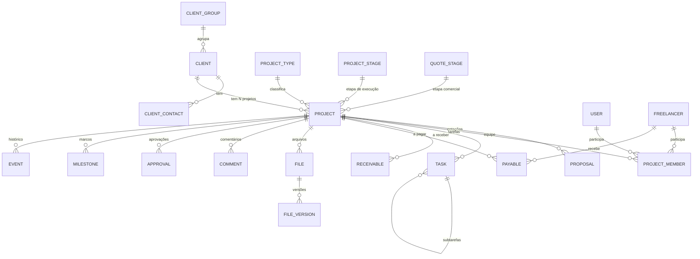

# Spec — Plataforma de Gestão Integrada (Draw)

> Documento de especificação para desenvolvimento orientado a spec (*spec-driven development*).
> Uso interno da equipe de produto e engenharia. Versão 0.4 · 22/11/2026.
>
> **Wiki viva do projeto.** Este arquivo mora no repositório (`docs/spec-plataforma-draw.md`) e é a referência fiel para quem
> constrói o back-end e o banco. Toda mudança de modelo, regra, etapa ou tela entra aqui **no mesmo commit** do código
> (Lei 11 do `CLAUDE.md`). Quando houver divergência, `src/data/types.ts` (modelo) e `src/data/services/*` (regras) são
> a implementação de referência e este documento deve ser corrigido.
>
> **Mudança da 0.2:** o sistema é feito de **módulos fixos** com o **projeto no centro**. Não existem quadros, colunas, campos ou automações criados pelo usuário (o modelo "Monday"). Processos, etapas e regras são definidos e testados no código.
>
> **Mudança da 0.3:** novo módulo **M11 — E-mail** (bônus): SMTP próprio da Draw configurável pelo admin e envio de e-mails de dentro do sistema com a conta de quem está logado, registrados no projeto. Login com Google entra como opcional **[A DECIDIR]**. Agenda Google sincronizada fica no futuro, com o requisito de verificação do Google documentado. A V2 passa a se chamar **Draw Case Room**.

> **Mudança da 0.4:** navegação em dois níveis ligados (seções no rail → itens no painel recolhível); visualizações de tarefas lista/kanban/calendário/Gantt em todos os lugares (RF-X-06). Front-end implementado (Next.js, dados locais com seed) e **validado contra a operação real da
> Draw**: planilha master de controle de projetos, quadro "1. Casos", quadro de áreas internas e estrutura de pastas do
> Drive. Etapas oficiais definidas (sai o [A VALIDAR]); novos campos (tamanho, pausa, política de pagamento do cliente,
> cobrança adicional, alíquota da organização, área das tarefas internas, ID legado); módulo de Arquivos vira **Drive**;
> mapeamento coluna a coluna da planilha → banco (seção 20); estado da implementação (seção 21).

>
> **Mudança da 0.5:** visualizações de tarefas em todos os lugares que listam tarefas — lista, kanban, calendário e Gantt (RF-X-06, RF-M4-17, RF-M6-06).
>
> **Mudança da 0.6:** qualidade percebida — micro-interações discretas (mudança de status, concluir tarefa, arrastar no kanban, confirmação de envio, entrada de listas, números e transição de página) e *skeletons* estruturais em todas as telas (seção 10.5). Sem impacto em modelo, regras ou contrato da API.

> **Mudança da 0.7:** **não há e-mail interno.** Saem do escopo: conectar a caixa do usuário (Gmail/SMTP), assinatura, aba **E-mails** do projeto e envio de e-mail pelo projeto (antigos RF-M11-02 a 07, RNF-14, ADR-009, tabelas `mail_accounts`, `mail_signatures`, `project_emails`) e notificações por e-mail/resumo diário (RF-M10-02/03). A **Caixa de entrada** é só dentro do sistema: menções (sempre entregues), comentários e eventos ligados a você, e o que interessa ao administrador. Ficam apenas os e-mails **transacionais** para pessoas de fora: convite, recuperação de senha e pedido de NF ao freelancer (RF-M11-01). Também: dados de cadastro (e-mail, telefone, CNPJ/CPF, chave PIX, dados bancários, nº de NF) copiáveis com um clique onde aparecem (RF-X-07). Freelancer ganha **cargo** (`job_title`, obrigatório no cadastro, com sugestões) exibido na lista, na ficha, na equipe do projeto e no seletor de pessoas; busca por cargo; coluna `cargo` na importação de freelancers.

> **Mudança da 0.8 (furos críticos do mapa de fluxos):** (1) **Acesso:** sessão só depois do 2FA; recuperação de senha real com token (hash, 1 h, uso único) e convites com token aleatório (7 dias, uso único, nunca o id); "Trocar perfil" e "Restaurar dados" só em modo de demonstração e registrados no log; **toda função da API aplica a matriz da seção 9** (RN-30 a RN-33; tabelas `password_resets`, `user_invites`). (2) **Comercial:** desarquivar volta ao status anterior (RN-50); **proposta, pedido de aprovação e entrega vão ao cliente por link público `/c/:token`** com e-mail transacional, e o cliente aprova ou pede ajustes por lá (RN-51, RN-52); a Caixa de entrada de cada perfil, inclusive o admin, mostra o que envolve a pessoa (RN-53) e menções guardam ids (RN-54). (3) **Financeiro:** registrar NF recebida por fora, recusar e pedir nova NF, decidir na conclusão o pagamento de freelancer sem valor e gerar pagamento avulso a freelancer (RN-40 a RN-43); importação da planilha master (XLSX/CSV, idempotente por `legacy_code`, RN-44).

> **Mudança da 0.9 (furos altos do mapa de fluxos):** (1) **Acesso/ADM:** rotina de prazos (prazo/atraso de tarefas e projetos, documentos vencendo — RN-34, tabela `due_alerts`); cancelar convite, convite de Freelancer cria o cadastro, perfil ajusta `user_type`, inativar exige sucessor (RN-35, RN-36); 2FA TOTP com códigos de recuperação, obrigatório para admin por padrão (RN-37); responsável por tarefa ADM muda o status (RN-38); `/minha-conta` com perfil, segurança e dados de pagamento do freelancer (RN-39); trilha de auditoria ampliada (RN-60). (2) **Comercial/Projetos:** pausado não muda etapa (RN-13); troca de responsável entra na equipe (RN-55); escopo de edição da Operação (RN-56); Minhas tarefas com subtarefas, projetos parados à parte e criação rápida (RN-57); desfazer aprovação (RN-58); reabrir concluído e reativar cancelado (RN-59); mudar equipe após concluir sugere pagamento (RN-70); descartar rascunho e comentário do cliente na aba Comentários (RN-71); tarefas do modelo por função e datas dentro do prazo, cotação nasce com tarefas (RN-72); entrega fatura parcela "na entrega" e cancelamento com prévia (RN-73); decisão do cliente move a etapa (RN-74). (3) **Financeiro:** prazo do cliente no vencimento e "Vencido" derivado (RN-45); rotina financeira avisa só o Financeiro envolvido e o freelancer acompanha o pagamento (RN-46); estornos com motivo (RN-47); margem com adicionais e impostos (RN-65); link de NF com dados mascarados e atualização do cadastro (RN-48); Financeiro edita política de cobrança do cliente (RN-49); painel respeita período e escopo "P" (RN-66); mensagem de cobrança para copiar e contato do Financeiro nas páginas públicas (RN-67); importação de recebíveis com estado (RN-69). Freelancer ganha cargo (`job_title`).
---

## 0. Como usar este documento

- Cada requisito tem um **ID estável** (`RF-…` funcional, `RN-…` regra de negócio, `RNF-…` não funcional, `ADR-…` decisão de arquitetura). Issues, PRs, testes e commits citam o ID.
- Requisitos têm **critérios de aceite**. Só está pronto quando todos passam em homologação.
- Releases: **R1** (primeira versão no ar, 20/12), **R2** (ajustes e go-live, janeiro), **Futuro** (seção 19).
- **[A VALIDAR]** depende da cliente. **[A DECIDIR]** depende de decisão técnica interna (seção 18).
- Mudança de escopo entra aqui primeiro, depois no código.

---

## 1. Visão

Plataforma web própria que substitui o Monday.com, as planilhas e a comunicação avulsa (WhatsApp, e-mail) da operação da Draw. **O projeto é o centro de tudo**: está sempre ligado a um cliente cadastrado, e comercial, execução, financeiro, arquivos, comunicação e indicadores se referem a ele. O banco é fortemente relacional para dar rastreio completo e permitir painéis ricos agora e no futuro.

### 1.1 Objetivos da V1

1. Centralizar a operação, com o projeto como prontuário completo e rastreável.
2. Visão consolidada para a gestão, sem trocar de tela.
3. Conectar Comercial → Projetos → Financeiro por regras de negócio no back-end.
4. Freelancers dentro da plataforma, vendo só o que é deles.
5. Indicadores gerados automaticamente a partir dos relacionamentos do banco.
6. Interface simples, limpa e rápida.

### 1.2 Não objetivos

- **Sem construtor de quadros, colunas, campos personalizados ou automações pelo usuário.** O escopo de módulos é fechado; evolução de processo é feita por desenvolvimento.
- **Sem IA, modelos preditivos ou LLM.** Todo indicador é determinístico.
- **Sem serviços cobrados por uso** quando houver alternativa no próprio servidor ou em plano gratuito (ex.: e-mail via Brevo/Resend, ADR-008).
- Sem portal do cliente e ambientes jurídicos na V1 (seção 19), mas com o modelo de dados pronto para eles.
- Sem app nativo nem publicação em lojas: o "app" é a própria plataforma instalada como **PWA** (RF-X-04).

---

## 2. Glossário

| Termo | Definição |
|---|---|
| **Organização** | Tenant da plataforma. Na V1 existe uma: a Draw. |
| **Módulo** | Parte fixa do sistema: Comercial, Projetos, Financeiro, Administrativo, Cadastros, Painel. |
| **Cliente** | Empresa atendida. Obrigatório em todo projeto. Pode pertencer a um grupo econômico e ter vários projetos. |
| **Projeto** | Unidade central de trabalho. **Na operação a equipe chama de "caso"** (quadro "1. Casos", planilha "Status Caso"); na plataforma o termo é Projeto. Código legível por tipo, ex.: `MEM-031`. |
| **Projeto interno** | Iniciativa da própria Draw (ex.: "Draw The Case Room"). Não tem cliente: é uma tarefa do módulo Administrativo na área `projetos_internos`. |
| **Área interna** | Agrupamento das tarefas internas: Administrativo, Comercial e Marketing, Projetos (internos), Financeiro, Outros. |
| **Drive** | Área de arquivos em pastas, seguindo a estrutura de pastas da Draw (seção 6.5). |
| **Pausado ("caso parado")** | Projeto ativo temporariamente parado (ex.: aguardando cliente). Não muda a etapa e sai dos alertas de prazo. |
| **Cobrança adicional** | Valor extra cobrado do cliente além do contratado (recebível do tipo `adicional`). |
| **Origem do projeto** | `cotacao` (nasce no Comercial e vira ativo ao aprovar a proposta) ou `direto` (nasce já aprovado, com financeiro preenchido). |
| **Tipo de projeto** | Item de catálogo (memorial jurídico, apresentação, contrato visual…). Define prefixo do código e modelo de tarefas. Mantido pelo admin. |
| **Etapa** | Fase fixa do processo (comercial ou de execução), definida no código. As colunas do kanban são as etapas. |
| **Proposta** | Cotação de um projeto, versionada. |
| **Tarefa** | Trabalho com responsável e prazo. Pertence a um projeto, ou ao módulo Administrativo. Pode ter subtarefas. |
| **Freelancer (prestador)** | Profissional externo alocado em projetos. |
| **Conta a receber** | Valor a faturar/receber do cliente, sempre ligado a um projeto. |
| **Conta a pagar** | Valor a pagar a um freelancer ou outro custo, sempre ligado a um projeto (exceto despesas administrativas). |
| **Evento** | Registro imutável de algo que aconteceu. Base do histórico, das métricas e das automações. |

---

## 3. Perfis

Perfis são **fixos** (definidos no código). O admin atribui um perfil a cada usuário e dá acesso a projetos.

| Perfil | Quem | Escopo |
|---|---|---|
| `admin` | Paula (CEO) | Tudo, incluindo configurações, valores, aprovações e cofre. |
| `gestao` | Beatriz | Comercial, Projetos, Administrativo; financeiro conforme definição **[A VALIDAR]**. |
| `comercial` | Quem conduz propostas | Comercial, clientes, leitura de projetos e faturamento relacionados. |
| `financeiro` | Responsável financeiro | Financeiro completo e leitura de projetos e clientes. |
| `operacao` | Equipe interna | Projetos e tarefas em que atua; sem valores. |
| `freelancer` | Designers, roteiristas, advogados | Só projetos em que está alocado; sem valores de terceiros, propostas ou faturamento. |
| `cliente` (futuro) | Usuários do cliente | Só projetos do próprio cliente. Previsto no modelo (`user_type = client`). |

Carga de referência: ~8 usuários no lançamento, ~20 simultâneos como teto de dimensionamento, ~100 freelancers e ~200 clientes cadastrados.

---

## 4. Princípios de arquitetura

| # | Princípio | O que fazer na V1 | O que isso destrava depois |
|---|---|---|---|
| P1 | **Projeto no centro** | Toda entidade operacional tem `project_id` (FK obrigatória quando aplicável). Telas de módulos são visões de projetos, nunca cópias. | Portal do cliente, ambientes e painéis leem o mesmo projeto. |
| P2 | **Cliente obrigatório e reutilizável** | `projects.client_id NOT NULL`. Cliente com grupo econômico e contatos. Um cliente, N projetos. | Área do cliente com acesso a todos os projetos dele, sem migração. |
| P3 | **Modelo relacional forte** | Chaves estrangeiras, `NOT NULL`, `CHECK` e índices em tudo que relaciona projeto, cliente, pessoa e dinheiro. Nada de dados de negócio em `jsonb` livre. | Dashboards confiáveis com SQL simples; integridade garantida pelo banco. |
| P4 | **Processo fixo, versionado no código** | Etapas e status em **tabelas de referência semeadas por migração** (`project_stages`, `quote_stages`), somente leitura para usuários. Mudar processo = migração + deploy. | Indicadores comparáveis no tempo; sem "colunas quebradas". |
| P5 | **Regras no back-end, nunca no usuário** | Automações (aprovação → financeiro, conclusão → pedido de NF) são serviços de domínio testados, disparados por eventos. Não existe construtor de automações. | Novas regras entram com teste e sem risco de quebrar fluxo. |
| P6 | **Multi-tenant desde o dia 1** | `organization_id` em toda tabela de domínio; políticas de **Row Level Security** escritas. | Isolamento de clientes nos ambientes da V2. |
| P7 | **Tipos de usuário e acesso por projeto** | `users.user_type ∈ {internal, freelancer, client}`; acesso a projeto por `project_members`; perfis fixos com matriz de permissões em **um único módulo de autorização** no back-end, com testes. | Usuários do cliente entram com o mesmo login e o mesmo motor. |
| P8 | **Event log de domínio** | Tabela `events` append-only para toda mudança relevante (quem, quando, antes/depois). Histórico, auditoria, notificações e métricas derivam dela. | Novas métricas sem reprocessar; webhooks futuros. |
| P9 | **Arquivos com versão e hash** | Abstração `StorageDriver` (disco local agora, S3-compatível depois); cada versão com `sha256`. | Prova de integridade da entrega na V2. |
| P10 | **Contrato de API primeiro** | OpenAPI antes do back-end; front com mocks (MSW). | Back-end escolhido depois sem travar o front. |
| P11 | **Jobs em fila no Postgres** | E-mails, importações, recálculo de métricas, lembretes. | Relatórios automáticos e NPS futuros sem infra nova. |
| P12 | **Links de compartilhamento genéricos** | `share_links` (token, expiração, senha opcional), já usado no formulário de NF do freelancer. | Publicação de memoriais com senha e expiração (V2). |
| P13 | **Módulos ligáveis** | `feature_flags` por organização para módulos futuros. | Portal, ambientes, marketing e horas entram desligados. |
| P14 | **Convenções** | IDs `uuid` v7; `created_at/updated_at/created_by`; *soft delete*; dinheiro em centavos (`bigint`); datas em UTC, exibidas em `America/Sao_Paulo`. | Consistência para relatórios e integrações. |

---

## 5. Stack

| Camada | Escolha |
|---|---|
| Front-end | **Next.js 15 (App Router) + React 19 + TypeScript** — decidido na implementação (ADR-011). Páginas são client components; nada de regra de negócio em server components |
| Roteamento / dados | App Router + TanStack Query (hooks em `src/data/hooks.ts`) |
| UI | **Tailwind CSS + shadcn/ui** (Radix), ícones lucide |
| Formulários | react-hook-form + zod (alinhado ao OpenAPI) |
| Drag-and-drop | dnd-kit (mudar etapa, reordenar prioridade) |
| Gráficos | Recharts (padrão shadcn charts) |
| Gantt | Componente próprio sobre a grade de datas **[A DECIDIR — ADR-004]** |
| PWA | `vite-plugin-pwa` (Workbox): manifest, service worker, prompt de atualização |
| Mocks | MSW gerado do OpenAPI |
| Testes front | Vitest + Testing Library; Playwright (E2E) |
| Banco | **PostgreSQL 16+** (`pgcrypto`, `citext`, `pg_trgm`, `unaccent`) |
| Back-end | **[A DECIDIR — ADR-001]**. Candidato: Node.js (Fastify ou NestJS) + ORM tipado. Requisitos na seção 11. |
| Fila | No Postgres (ex.: pg-boss) |
| E-mail | **Brevo** (principal) e **Resend** (reserva), nos planos gratuitos, atrás da abstração `MailTransport` (RNF-12); templates compatíveis com Gmail e Outlook |
| Infra | Front: **Cloudflare Workers** via OpenNext (ADR-012). Back-end: VPS + Docker Compose, proxy reverso com TLS; homologação e produção separadas |

---

## 6. Modelo de dados

> Nomes em inglês no banco; rótulos em português na interface. Toda tabela de domínio tem `id uuid`, `organization_id`, `created_at`, `updated_at`, `created_by`, `deleted_at`.

### 6.1 Identidade e acesso

| Tabela | Campos principais |
|---|---|
| `organizations` | `name`, `slug`, `settings jsonb` (somente parâmetros técnicos): `freelancer_payment_day` (20), `due_soon_days` (2), `tax_rate_pct` (6 — alíquota sobre faturamento usada na planilha), `require_mfa_for_admins` (true — RN-37), `finance_contact_email` e `finance_contact_phone` (opcionais — contato do Financeiro nas páginas públicas, RN-67) |
| `users` | `email citext unique`, `name`, `user_type` (`internal`/`freelancer`/`client`), `role` (enum fixo), `password_hash` (argon2id), `mfa_enabled`, `mfa_secret` (cifrado), `mfa_pending_secret` (cadastro iniciado, cifrado), `mfa_recovery_codes text[]` (hash de cada código ainda não usado), `mfa_enrolled_at`, `status`, `last_login_at` — segredos e códigos nunca saem na API (RN-37) |
| `sessions` | sessões (cookie httpOnly) criadas **só depois do 2FA** (RN-30); revogadas ao redefinir a senha (RN-31). Mock: `users.session_version` (a sessão guardada com versão antiga deixa de valer) |
| `password_resets` | `user_id`, `token_hash` (SHA-256; o token em claro só vai no e-mail), `expires_at` (1 h), `used_at` — RN-31 |
| `user_invites` | `user_id`, `token_hash` (SHA-256, token aleatório de 256 bits), `expires_at` (7 dias), `used_at`, `revoked_at` (reenviar/gerar link novo revoga o anterior) — RN-32 |
| `project_members` | `project_id`, `user_id` **ou** `freelancer_id`, `member_role` (`responsavel`/`designer`/`roteirista`/`advogado`/`apoio`), `agreed_amount_cents` (só para freelancer), `active`, `payment_waived` (bool, default `false`: freelancer marcado "sem pagamento" na conclusão — RN-40) |
| `feature_flags` | `organization_id`, `key`, `enabled` |
| `access_logs` | `action`: `login`, `login_failed`, `mfa_failed`, `logout`, `secret_revealed`, `sensitive_access`, `password_reset_requested`, `password_reset_done`, `invite_accepted`, `impersonate` (só demonstração: quem → qual perfil), `demo_reset`; trilha de segurança (RN-60): `invite_sent`, `invite_cancelled`, `role_changed`, `user_deactivated`, `user_reactivated`, `password_changed`, `profile_updated`, `mfa_enabled`, `mfa_disabled`, `mfa_recovery_used`, `mfa_recovery_regenerated`, `bank_data_changed`; `user_id` = quem fez; `detail` (alvo e antes → depois) |

### 6.2 Cadastros

| Tabela | Campos principais |
|---|---|
| `client_groups` | `name` |
| `clients` | `group_id` (nulo), `legal_name`, `trade_name`, `cnpj` (único por organização, validado), `address` (colunas próprias), `segment`, `status`, `notes`, `payment_terms_note` (texto, ex.: "20 dias após emissão da NF"), `payment_term_days` (int, nulo) |
| `client_contacts` | `client_id`, `name`, `email`, `phone`, `job_title`, `is_billing_contact`, `is_decision_maker` |
| `freelancers` | `user_id` (nulo até ter login), `name`, `email`, `phone`, `job_title` (cargo/área de atuação, obrigatório no cadastro — ex.: Designer gráfico, Advogado revisor), `legal_name`, `document` (CPF/CNPJ, cifrado), `pix_key` (cifrado), `bank_*` (cifrados), `status`, `notes` |
| `freelancer_specialties` | `freelancer_id`, `specialty` (enum: `design`/`roteiro`/`juridico`/`outro`) |
| `project_types` | `name`, `code_prefix` (único), `description`, `active`. **Catálogo mantido pelo admin.** |
| `project_type_task_templates` | `project_type_id`, `stage_key`, `title`, `order`, `default_duration_days`, `default_role` (papel da equipe que recebe a tarefa; nulo = padrão da etapa — RN-72) |

### 6.3 Processo (tabelas de referência, semeadas por migração)

| Tabela | Conteúdo inicial |
|---|---|
| `quote_stages` | `entrada` ("Possíveis casos"), `diagnostico`, `elaboracao` ("A fazer proposta"), `enviada`, `negociacao`, `aprovada`, `perdida` |
| `project_stages` | `roteiro`, `ajustes_roteiro`, `design`, `ajustes_design`, `validacao_cliente` ("Com cliente para validação"), `concluido` — **oficiais**, espelham o quadro "1. Casos" da Draw (22/11/2026). O projeto aprovado entra em `roteiro` |
| `adm_areas` | `administrativo`, `comercial_marketing`, `projetos_internos`, `financeiro`, `outros` (quadro "Visão geral da empresa") |
| `project_sizes` | `pequeno`, `medio`, `grande` (planilha: Tamanho) |
| `payment_conditions` | `a_vista`, `50_50`, `parcelado` (planilha: Condição de Pagamento) |
| `task_statuses` | `a_fazer`, `em_andamento`, `em_revisao`, `concluida` |
| `priorities` | `baixa`, `media`, `alta`, `urgente` |

Cada linha tem `key`, `label`, `order`, `category` (`open`/`waiting`/`done`/`lost`). Usuários não editam essas tabelas.

### 6.4 Projetos e trabalho

| Tabela | Campos principais |
|---|---|
| `projects` | `client_id` **NOT NULL**, `project_type_id` **NOT NULL**, `code` (único; RN-05), `title`, `briefing`, `origin` (`cotacao`/`direto`), `status` (`cotacao`/`ativo`/`concluido`/`arquivado`/`perdido`/`cancelado`), `quote_stage_key` (quando `cotacao`), `project_stage_key` (quando `ativo`), `priority_key`, `owner_id`, `billing_contact_id`, datas: `entered_at`, `quote_sent_at`, `approved_at`, `started_at`, `due_at`, `estimated_end_at`, `completed_at`, `archived_at`; `contracted_amount_cents`, `lost_reason`, `is_environment` (futuro, default `false`), `size` (ref. `project_sizes`, nulo), `payment_condition` (nulo), `paused_at` + `paused_reason` ("caso parado"), `status_before_archive` (status em que estava ao arquivar; o desarquivar volta a ele — RN-50), `legacy_code` (ID da planilha, ex.: `P001`, único por organização quando presente — chave da importação) |
| `proposals` | `project_id`, `version`, `amount_cents`, `payment_terms` (parcelas: tabela `proposal_installments`), `status` (`rascunho`/`enviada`/`aprovada`/`recusada`), `sent_at`, `approved_at`, `file_id` |
| `proposal_installments` | `proposal_id`, `number`, `amount_cents`, `due_rule` ou `due_at` |
| `tasks` | `project_id` (nulo só para tarefas do módulo Administrativo), `module` (`projeto`/`adm`), `parent_task_id`, `stage_key` (etapa do projeto a que pertence), `title`, `description`, `assignee_user_id` ou `assignee_freelancer_id`, `status_key`, `priority_key`, `start_at`, `due_at`, `estimate_minutes`, `position` (fractional index), `sprint_id`, `completed_at`, `area` (ref. `adm_areas`; só quando `module = adm`) |
| `sprints` | `name`, `start_at`, `end_at`, `status` (módulo Administrativo) |
| `milestones` | `project_id`, `title`, `date`, `learning` |
| `project_deliverable_metrics` | `project_id`, `metric` (enum fixo: `paginas_antes`, `paginas_depois`, `tempo_leitura_antes`, `tempo_leitura_depois`…), `value` **[A VALIDAR lista]** |

### 6.5 Colaboração e arquivos

| Tabela | Campos principais |
|---|---|
| `comments` | `project_id`, `task_id` (nulo), `author_id` (nulo = comentário externo do cliente pelo link), `body`, `mentions uuid[]`, `external_author_name` (nome informado pelo cliente no link — RN-71) |
| `approvals` | `project_id`, `stage_key`, `requested_from`, `decision` (`pendente`/`aprovado`/`ajustes`/`negado`), `reason`, `decided_by` (nulo quando o cliente decide pelo link), `decided_at`, `requested_by` (quem pediu — recebe a decisão), `share_link_id` (link `aprovacao` enviado ao cliente), `decided_via` (`interno`/`link_cliente`), `decided_by_name` (nome informado pelo cliente no link) |
| `folders` | `parent_id` (nulo = raiz), `name`, `system_key` (raízes fixas), `allowed_roles role[]` (vazio = todos os internos), `order`. Raízes semeadas: `01. Projetos`, `02. Vendas`, `03. Financeiro` (admin/gestão/financeiro), `04. Adm & Operacional`, `05. Marketing`, `06. Design`, `07. Cérebro Draw`, `08. Cérebro Paula` (só admin), `10. Estratégia`, `11. Jurídico & RH`, `Eventos 2026`, `Planilha Projetos Marina e equipe`. Raízes não são renomeadas nem excluídas |
| `files` | `project_id` (ou `client_id`, ou `module = adm`), `folder_id` (nulo para arquivos de projeto), `task_id` (nulo), `category` (`entrega`/`briefing`/`marca_cliente`/`proposta`/`nf`/`institucional`/`outro`), `name`, `current_version_id`, `released_to_freelancers`. **Em `01. Projetos` as pastas são virtuais**: `<Cliente>/<Código — Título>` montadas pelos relacionamentos (arquivo continua ligado ao projeto — P1) |
| `file_versions` | `file_id`, `version`, `storage_key`, `size`, `mime`, `sha256`, `uploaded_by`, `note` |
| `share_links` | `token_hash`, `purpose` (`nf_freelancer` → payable; `proposta` → proposal; `aprovacao` → approval; `entrega` → project), `project_id`, `target_id`, `expires_at` (30 dias), `password_hash`, `max_uses`, `use_count`, `revoked_at`, `file_version_ids uuid[]` (arquivos liberados no link), `recipients text[]` (e-mails dos contatos do cliente), `message`, `last_sent_at`, `viewed_at` (primeira abertura), `responded_at`, `response` (`aprovado`/`ajustes`), `response_comment`, `respondent_name`. Status mostrado é derivado: enviado → visto → aprovado / ajustes pedidos; ou expirado, revogado, encerrado (alvo decidido por dentro) — RN-51/52 |

### 6.6 Financeiro (sempre por projeto)

| Tabela | Campos principais |
|---|---|
| `receivables` | `project_id` **NOT NULL**, `client_id`, `proposal_installment_id` (nulo em projeto direto ou adicional), `kind` (`parcela`/`adicional`), `description`, `amount_cents`, `tax_cents` (= `amount × tax_rate_pct`), `expected_at`, `invoice_number`, `invoice_file_id`, `issued_at`, `received_at`, `status` (`previsto`/`faturado`/`recebido`/`cancelado` gravados; `vencido` é **derivado** — RN-45), `collection_note` (comentário de cobrança), `cancel_reason` (motivo do cancelamento — RN-85), `due_basis` (texto da regra que definiu o vencimento — RN-45; nulo = informado à mão) |
| `payables` | `project_id` (nulo só em despesa administrativa), `kind` (`freelancer`/`despesa_projeto`/`despesa_adm`), `freelancer_id`, `project_member_id`, `description`, `agreed_amount_cents`, `invoiced_amount_cents`, `invoice_file_id`, `due_at`, `paid_at`, `status` (`aguardando_nf`/`em_conferencia`/`divergente`/`aprovado`/`pago`/`cancelado` — RN-86), `divergence_note`, `cancel_reason` (RN-86), `payee_name` e `category` (favorecido e categoria da despesa — RN-87), `invoice_issued_at` (data de emissão da NF quando registrada manualmente — RN-41). Freelancer pode ter mais de um pagável no mesmo projeto só como pagamento adicional explícito (RN-43) |
| `freelancer_invoice_requests` | `payable_id`, `share_link_id`, `sent_at`, `submitted_at`, dados declarados (colunas), `source` (`formulario`/`manual`, nulo enquanto aguarda), `reissue_reason` + `reissue_requested_at` (último pedido de nova NF — RN-42; o histórico completo fica em `events`) |
| `v_project_financials` (view) | por projeto: contratado, previsto, faturado, recebido, a receber, custo com freelancers, outras despesas, **adicionais**, **receita** (contratado + adicionais), **impostos**, **margem** e **margem %** (sobre a receita) — RN-65; **soma das parcelas × contratado** (`parcels_cents`, `parcels_gap_cents`) para o aviso de parcelas que não fecham — RN-90 |

### 6.7 Administrativo

| Tabela | Campos principais |
|---|---|
| `institutional_documents` | `title`, `category`, `file_id`, `valid_until` |
| `vault_items` | `title`, `url`, `username`, `secret` (cifrado), `notes` (cifrado), `allowed_roles` |
| `vault_access_logs` | `vault_item_id`, `user_id`, `action`, `at` |
| `resources` | `title`, `url`, `category` (enum fixo), `description` |

### 6.8 Plataforma

| Tabela | Campos principais |
|---|---|
| `events` | `entity_type`, `entity_id`, `project_id`, `client_id` (desnormalizados para consulta), `actor_id`, `type` (ex.: `project.stage_changed`), `data jsonb` (antes/depois), `occurred_at`. **Append-only.** |
| `notifications` | `user_id`, `type` (`atribuicao`, `mencao`, `prazo`, `atraso`, `aprovacao`, `nf_solicitada`, `nf_recebida`, `etapa`, `projeto`, `comentario`, `cliente`, `revisao`, `cadastro` — freelancer mudou os próprios dados de pagamento, RN-39; `vencimento`, `pagamento` — RN-46), `project_id`, `entity_type`, `entity_id`, `title`, `body`, `read_at` — destinatários pela RN-53 |
| `notification_preferences` | `user_id`, `type`, `enabled` (só no app — Caixa de entrada; `mencao` não pode ser desligada) |
| `due_alerts` | `key` (**único**; ex.: `prazo:task:<id>:<due_at>:<user_id>`, `doc:<id>:<valid_until>:d30:<user_id>`), `sent_at` — marcas da rotina de prazos para não repetir aviso (RN-34) |
| `imports` | `kind` (`clientes`/`freelancers`/`recebiveis`/`planilha_master`), `source_file_id`, `status`, `mapping jsonb`, `report jsonb` (total, ok, erros por linha, `summary` com contagens por entidade), `dry_run` |
| `email_logs` | `channel` (`system` — só transacional para pessoas de fora), `provider` (`brevo`/`resend`/`draw_smtp`), `user_id`, `project_id` (nulo para e-mails do sistema sem projeto), `provider_message_id`, `to`, `cc`, `subject`, `template`, `status` (`queued`/`sent`/`delivered`/`bounced`/`complained`/`failed`), `error`, `sent_at` |
| `email_provider_usage` | `provider`, `date`, `sent_count` (base do limite diário e do fallback) |
| `system_mail_settings` | `transport` (`brevo_resend`/`draw_smtp`), `smtp_host`, `smtp_port`, `smtp_security`, `smtp_user`, `smtp_password` (cifrado), `from_name`, `from_address` — um registro por organização |

### 6.9 Integridade obrigatória (exemplos de `CHECK`/regras no banco)

- `projects.status = 'ativo'` exige `approved_at` e `contracted_amount_cents`.
- `projects.status = 'cotacao'` exige `quote_stage_key`; `ativo` exige `project_stage_key`.
- `receivables.project_id` obrigatório; `receivables.client_id` igual ao cliente do projeto (garantido por trigger ou FK composta).
- `payables.kind = 'freelancer'` exige `freelancer_id` e `project_member_id` do mesmo projeto.
- `project_members` exige exatamente um entre `user_id` e `freelancer_id`.

---

## 7. Requisitos funcionais (V1)

### M1 — Usuários e acesso

| ID | Requisito | Release |
|---|---|---|
| RF-M1-01 | Login por e-mail e senha, sessão por cookie httpOnly, recuperação de senha. | R1 |
| RF-M1-02 | Convite por e-mail com perfil definido; o convidado cria a senha. | R1 |
| RF-M1-03 | Listar, editar perfil e inativar usuários (sem apagar histórico). Cancelar convite pendente; perfil Freelancer sempre ligado a um cadastro de freelancer (RN-35); inativar mostra as pendências (projetos, tarefas, equipes) e reatribui a quem assume (RN-36). | R1 |
| RF-M1-04 | Autorização centralizada no back-end (P7) aplicada em todas as rotas; o front só reflete. | R1 |
| RF-M1-05 | Campos de valor removidos da resposta da API para perfis sem permissão. | R1 |
| RF-M1-06 | 2FA (TOTP) com cadastro (QR + chave manual, confirmação por código) e 10 códigos de recuperação; obrigatório para `admin` enquanto a organização exigir (RN-37). Minha conta › Segurança: ligar, gerar novos códigos e desligar (com a senha). | R1 |

Aceite: freelancer que pede um projeto em que não está alocado recebe `404`; usuário `operacao` nunca recebe campos de valor no JSON.

### M2 — Cadastros

| ID | Requisito | Release |
|---|---|---|
| RF-M2-01 | Clientes com CNPJ validado e único; grupo econômico; contatos (faturamento, decisor). | R1 |
| RF-M2-02 | Ficha do cliente: todos os projetos, propostas, recebíveis e indicadores do cliente (conforme permissão). | R1 |
| RF-M2-03 | Ao escolher o cliente no projeto, trazer CNPJ, razão social e contato de faturamento. | R1 |
| RF-M2-04 | Freelancers com especialidades, dados fiscais e bancários cifrados; ficha com projetos, entregas, pagamentos e carga atual. E-mail único entre freelancers e usuários (409); com login vinculado, mudar o e-mail do freelancer muda o e-mail de acesso (`user.email_changed` + `freelancer.email_changed`, com antes/depois). | R1 |
| RF-M2-05 | Catálogo de tipos de projeto (admin): nome, prefixo, modelo de tarefas por etapa. | R1 |
| RF-M2-06 | Consulta pública de CNPJ para preencher cadastro **[A DECIDIR fonte sem custo por uso]**. | R2 |

### M3 — Comercial

| ID | Requisito | Release |
|---|---|---|
| RF-M3-01 | Funil de projetos em cotação por etapa fixa (`quote_stages`), em kanban e lista. | R1 |
| RF-M3-02 | Criar projeto em cotação: cliente (obrigatório; cadastrar na hora se novo), tipo, título, responsável. | R1 |
| RF-M3-03 | Tarefas da cotação com prazo e responsável (ex.: elaborar proposta) — geradas ao criar a cotação (RN-72). | R1 |
| RF-M3-04 | Propostas versionadas com valor, parcelas e arquivo; datas de envio e aprovação registradas pelo sistema. | R1 |
| RF-M3-07 | **Enviar proposta ao cliente** (RN-51): escolher destinatários entre os contatos do cliente (padrão: contato de cobrança/decisor) e um recado; o sistema marca a proposta como enviada, cria o link público `/c/:token` (30 dias, revogável) e envia e-mail transacional. O cliente vê versão, escopo, valor, parcelas e PDF e responde **Aprovar proposta** ou **Pedir ajustes** (comentário obrigatório). "Propostas enviadas ao cliente" no prontuário mostra status (enviado, visto, aprovado, ajustes pedidos, expirado, revogado) com reenviar/revogar. | R1 |
| RF-M3-05 | Aprovar proposta dispara RN-01; perder exige motivo. | R1 |
| RF-M3-06 | Filtros por etapa, cliente, responsável, tipo e período. | R1 |

### M4 — Projetos

| ID | Requisito | Release |
|---|---|---|
| RF-M4-01 | **Criar projeto direto** (origem `direto`): cliente, tipo, título, valor contratado, parcelas a receber, equipe e prazo; entra como `ativo` e gera recebíveis (RN-02). | R1 |
| RF-M4-02 | Projetos ativos por etapa fixa (`project_stages`) em **kanban** e **lista**; **calendário** e **Gantt** na R2. | R1 / R2 |
| RF-M4-03 | Cartão do projeto: código, cliente, título, prioridade, prazo, equipe, progresso de subtarefas, atraso, status de aprovação e faturamento. | R1 |
| RF-M4-04 | Página do projeto (prontuário), abas: Visão geral · Tarefas · Equipe · Arquivos · Comentários · Aprovações · Financeiro · Histórico. | R1 |
| RF-M4-05 | Ao ativar, gerar tarefas a partir do modelo do tipo de projeto, por etapa, distribuídas pela equipe por papel e com datas dentro do prazo do projeto (RN-72). | R1 |
| RF-M4-06 | Tarefas e subtarefas com responsável (interno ou freelancer), prazo, prioridade, status, estimativa. | R1 |
| RF-M4-07 | Prioridade manual por arrastar dentro da etapa. | R1 |
| RF-M4-08 | "Minhas tarefas": atrasadas, hoje, esta semana, depois — inclui subtarefas atribuídas à pessoa e separa as de projetos parados ou encerrados (RN-57); "Nova tarefa" cria direto, atribuída a quem cria, num projeto ativo/cotação visível (Tarefas com escrita) ou no Administrativo (ADM **T**). | R1 |
| RF-M4-09 | Filtro por pessoa, cliente, tipo e prazo. | R1 |
| RF-M4-10 | Aprovações por etapa; "ajustes" e "negado" exigem motivo **[A VALIDAR]**. Uma aprovação é decidida uma vez só (409 se já decidida). | R1 |
| RF-M4-18 | **Pedir aprovação ao cliente** e **Enviar entrega ao cliente** (aba Aprovações, RN-52): destinatários entre os contatos do cliente, arquivos escolhidos (versão atual; nunca proposta/NF) e recado → link público `/c/:token` (purposes `aprovacao`/`entrega`, 30 dias) + e-mail transacional. Na aprovação o cliente aprova ou pede ajustes, e a decisão fica na Approval (`decided_via = link_cliente`). "Envios ao cliente" lista os links com status, copiar link, reenviar e revogar. "Registrar pedido…" continua para pedidos feitos fora do sistema. | R1 |
| RF-M4-11 | Materiais de apoio liberados ao freelancer (manual de marca do cliente, tom de voz…). | R1 |
| RF-M4-12 | Concluir projeto dispara RN-03; arquivar mantém tudo (RN-07). | R1 |
| RF-M4-13 | Alertas de prazo próximo (padrão 2 dias) e atraso — na tela (faixa de alertas) e na Caixa de entrada: `prazo` (vence em até 2 dias) e `atraso` para o responsável do projeto ativo não pausado e para o responsável de cada tarefa aberta (fora de projeto pausado/encerrado), um aviso por pessoa, item e data de prazo (idempotente). No back-end: job diário; no front local, `deadlineAlertsApi.sweep` roda ao abrir a sessão. | R1 |
| RF-M4-17 | Aba **Tarefas** do prontuário e **Minhas tarefas** nas visões lista, kanban por status, calendário e Gantt (RF-X-06). | R1 |
| RF-M4-14 | Marcos e aprendizados; métricas de entrega (`project_deliverable_metrics`). | R2 |
| RF-M4-15 | Pausar/retomar projeto (RN-13) com motivo; selo "Parado" em cartões, linhas e prontuário; filtro "Situação". Tamanho (P/M/G) e condição de pagamento no prontuário e no assistente — "À vista" gera 1 parcela, "50/50" gera 2 (na aprovação / na entrega). | R1 |
| RF-M4-16 | Cobrança adicional pelo prontuário (RN-14) e comentário de cobrança por recebível; ao emitir NF, sugerir vencimento pelo prazo do cliente (`payment_term_days`). | R1 |

### M5 — Financeiro

| ID | Requisito | Release |
|---|---|---|
| RF-M5-01 | Contas a receber geradas por RN-01/RN-02, sempre ligadas ao projeto. | R1 |
| RF-M5-02 | Emissão de NF (número, arquivo, data) e baixa de recebimento. | R1 |
| RF-M5-03 | Contas a pagar a freelancers por RN-03; despesas de projeto e administrativas lançadas manualmente. | R1 |
| RF-M5-04 | Formulário público (via `share_links`) para o freelancer enviar NF e confirmar dados de pagamento — sem expor documento/PIX completos nem dados bancários (RN-48), com o contato do Financeiro (RN-67). | R1 |
| RF-M5-05 | Conferência valor acordado × valor da NF (RN-04). | R1 |
| RF-M5-06 | **Financeiro do projeto:** contratado, faturado, recebido, custos e margem (`v_project_financials`). | R1 |
| RF-M5-07 | Visões consolidadas: a receber, a pagar, por mês, por cliente, por tipo de projeto. | R1 |
| RF-M5-08 | Importação e exportação de planilha (XLSX/CSV) com pré-visualização e relatório de erros. | R1 |
| RF-M5-09 | **NF recebida fora do formulário:** em `aguardando_nf` ou `divergente`, o Financeiro registra nº, valor, data de emissão e PDF (opcional, recomendado); segue a conferência pela RN-04 (RN-41). | R1 |
| RF-M5-10 | **Pedir nova NF:** NF em conferência ou divergente é recusada com motivo; o pagável volta a `aguardando_nf`, o link é renovado e o freelancer é avisado por e-mail e na Caixa de entrada; o formulário público aceita o novo envio e mostra o motivo (RN-42). | R1 |
| RF-M5-12 | **Desfazer no financeiro:** estornar baixa, cancelar NF emitida, desfazer aprovação de pagável e estornar pagamento, com motivo e histórico (RN-47). | R1 |
| RF-M5-11 | **Pagamento a freelancer sem depender da conclusão:** "Novo pagamento a freelancer…" (A pagar) e "Gerar pagamento / pedido de NF…" (prontuário › Equipe) criam o pagável `aguardando_nf` + link + e-mail, idempotente por membro (RN-43). Na conclusão, freelancer sem valor ou removido da equipe é decidido no diálogo (RN-40). | R1 |

### M6 — Administrativo

| ID | Requisito | Release |
|---|---|---|
| RF-M6-01 | Tarefas internas (`module = adm`) com backlog e sprints. | R2 |
| RF-M6-02 | Documentos institucionais com validade e alerta. | R2 |
| RF-M6-03 | Cofre de credenciais cifrado, com log de revelação. | R2 |
| RF-M6-04 | Biblioteca de recursos (ferramentas, templates, playbooks). | R2 |
| RF-M6-05 | **Quadro por área** (visão padrão de `/adm/tarefas`): colunas 2. Administrativo · 3. Comercial e Marketing · 4. Projetos · 5. Financeiro · 6. Outros; arrastar muda `tasks.area`; adição rápida por coluna. | R1 |
| RF-M6-06 | `/adm/tarefas` com seletor de visão (lista · kanban · calendário · Gantt) aplicado à aba ativa — Por área (kanban = quadro de áreas), Sprint atual e Backlog (kanban por status); a aba Sprints não tem visão de tarefas (RF-X-06). | R1 |

### M7 — Arquivos

| ID | Requisito | Release |
|---|---|---|
| RF-M7-01 | Upload múltiplo por arrastar; limite por arquivo **[A VALIDAR]**. | R1 |
| RF-M7-02 | Versões com `sha256`; anteriores preservadas. | R1 |
| RF-M7-03 | Biblioteca por projeto e por cliente, com categorias e busca. | R2 |
| RF-M7-04 | Download por permissão, com link assinado de curta duração. | R1 |
| RF-M7-05 | **Drive** em `/arquivos?pasta=<id>` seguindo a estrutura de pastas da Draw (01. Projetos … Planilha Projetos Marina e equipe): árvore lateral, breadcrumb, grade/lista, busca na pasta, nova pasta, renomear, excluir (só vazia), enviar por arrastar e "Mover para…". Em 01. Projetos as pastas são virtuais por cliente (`cli:<id>`) e projeto (`prj:<id>`); os arquivos do projeto continuam ligados ao projeto (aba Arquivos do prontuário). Freelancer só vê 01. Projetos. | R1 |

### M8 — Painel e indicadores

| ID | Requisito | Release |
|---|---|---|
| RF-M8-01 | Painel da gestão: projetos por etapa, atrasos, entregas da semana, cotações abertas, a receber e a pagar do mês. | R2 |
| RF-M8-02 | Atividade do time por pessoa. | R2 |
| RF-M8-03 | Indicadores da seção 12, com período e exportação CSV. | R2 |
| RF-M8-04 | Carga por pessoa e por freelancer. | R2 |
| RF-M8-05 | Burndown por projeto. | R2 |
| RF-M8-06 | **Visão geral da empresa** no Início: casos · projetos internos · pendências (+ parados), como no quadro atual da Draw (`metrics.companyOverview`). | R1 |

### M9 — Área do freelancer

| ID | Requisito | Release |
|---|---|---|
| RF-M9-01 | Início: seus projetos e tarefas por prazo, com alertas. | R1 |
| RF-M9-02 | Atualizar status, comentar e enviar arquivos. | R1 |
| RF-M9-03 | Materiais liberados do projeto. | R1 |
| RF-M9-04 | Calendário pessoal; a gestão vê a disponibilidade de todos. | R2 |
| RF-M9-05 | Envio de NF e dados de pagamento ao fim do projeto. | R1 |
| RF-M9-06 | **Meus pagamentos** no menu do freelancer (Início › Você e seção Financeiro, `/financeiro/pagar` no modo freelancer) e **Meus dados de pagamento** em Minha conta (`/minha-conta?aba=dados`): telefone, nome/razão social para NF, CPF/CNPJ, PIX e banco do próprio cadastro (RN-39). | R1 |

### M10 — Notificações

| ID | Requisito | Release |
|---|---|---|
| RF-M10-01 | Só no app (Caixa de entrada — **não há e-mail interno**): atribuição, menção (sempre entregue), prazo, atraso, aprovação, NF solicitada/recebida, mudança de etapa, situação do projeto (pausa, retomada, conclusão, cancelamento), comentário, resposta do cliente pelo link, tarefa em revisão, vencimentos financeiros (recebível vencido/a vencer, NF de freelancer pendente — RN-46) e andamento do pagamento do freelancer (NF divergente/aprovada, pago, estornado — RN-46). Cada tipo, exceto menção, pode ser silenciado em Preferências. A caixa mostra só o que envolve a pessoa (RN-53) — para todos os perfis, inclusive Administrador — e pode ser agrupada por projeto (`?agrupar=projeto`). | R1 |
| RF-M10-02 | Menções escolhidas na lista de sugestões (responsável e equipe do projeto, inclusive freelancers com acesso); o comentário guarda os ids escolhidos (RN-54). | R1 |

### M11 — E-mail transacional do sistema

Não há e-mail interno (decisão da 0.7): a comunicação da equipe acontece na plataforma (comentários, menções, Caixa de entrada). O sistema só envia e-mails **transacionais para pessoas de fora** — convite, recuperação de senha, pedido/lembrete de NF ao freelancer e os envios ao cliente (proposta, pedido de aprovação, entrega — modelos `proposta_cliente`, `aprovacao_cliente`, `entrega_cliente`, sempre por `queueSystemEmail`) —, em nome da plataforma (ex.: `nao-responda@draw...`). Transporte padrão Brevo + Resend (RNF-12); o admin pode configurar o **SMTP próprio da Draw** como principal.

| ID | Requisito | Release |
|---|---|---|
| RF-M11-01 | Tela de configuração de e-mail do sistema (admin): escolher transporte (Brevo/Resend padrão, ou SMTP próprio), host, porta, segurança (STARTTLS/SSL), usuário, senha (cifrada), remetente e botão "Enviar e-mail de teste". | R2 |

Fora do escopo: enviar ou ler e-mails de usuários dentro do sistema. Conversas com cliente e freelancer seguem nos canais de cada pessoa; o registro do que importa fica no projeto (comentários, arquivos, aprovações).

### Transversais

| ID | Requisito | Release |
|---|---|---|
| RF-X-01 | Busca global (projetos, clientes, freelancers, tarefas). | R2 |
| RF-X-02 | Histórico de eventos em projeto, tarefa, proposta e lançamento financeiro. | R1 |
| RF-X-03 | Estados vazio, carregando e erro em todas as telas. | R1 |
| RF-X-04 | **PWA instalável** (bônus incluído na V1): manifest, ícones e service worker desde o primeiro deploy; instalável no Android, iPhone/iPad, Windows e macOS sem loja. Detalhes em 10.6. | R1 |
| RF-X-05 | **Responsivo** em computador, tablet e celular, com padrões de navegação próprios por faixa de tela (10.6). | R1 |
| RF-X-06 | **Visualizações de tarefas**: todo lugar que lista tarefas oferece as mesmas visões dos projetos — **lista**, **kanban** (por status; em Administrativo › Por área as colunas são as áreas), **calendário** (pelo prazo) e **Gantt** (início → prazo). Visão na URL (`?visao=`); tarefas sem data mostram o aviso "N tarefas sem data" com atalho para a lista; no celular a lista é a visão padrão, o kanban mostra uma coluna por vez, o calendário vira agenda e o Gantt rola na horizontal. Abrir a tarefa segue pelo peek (`?tarefa=`). Componente único `TaskViews`. Vale para Minhas tarefas, aba Tarefas do prontuário (M4), Administrativo (M6) e início do freelancer. | R1 |
| RF-X-07 | Dados de cadastro que precisam ser colados em outro lugar (e-mail, telefone, CNPJ/CPF, chave PIX, banco/agência/conta, nº de NF) têm botão de copiar com um clique, com confirmação; dado protegido sem permissão não é copiável. | R1 |

---

## 8. Regras de negócio

| ID | Regra |
|---|---|
| RN-01 | **Proposta aprovada** → projeto passa de `cotacao` a `ativo` na primeira etapa de execução; `approved_at` e `contracted_amount_cents` preenchidos; recebíveis criados das parcelas; tarefas do modelo geradas. Uma transação; evento `proposal.approved`. |
| RN-02 | **Projeto direto** → criado já `ativo`; exige cliente, valor contratado e ao menos uma parcela; recebíveis criados das parcelas informadas. |
| RN-03 | **Projeto concluído** → para cada freelancer com valor acordado, cria `payable` em `aguardando_nf`, gera `share_link` (30 dias) e envia e-mail. |
| RN-04 | NF do freelancer: valor diferente do acordado → `divergente` com nota; igual → `em_conferencia`. Aprovação manual → `aprovado`. |
| RN-05 | Código do projeto: `{prefixo do tipo}-{sequencial de 3 dígitos}`, sequência por prefixo, nunca reutilizada. |
| RN-06 | Vencimento do pagamento ao freelancer: dia 20 do mês seguinte à conclusão **[A VALIDAR exceções]**; dia parametrizado em `organizations.settings`. |
| RN-07 | Arquivar não apaga; arquivados saem das visões ativas e seguem em busca e relatórios. |
| RN-08 | Freelancer vê só projetos com `project_members.active = true`; ao sair, perde acesso, mas seus registros permanecem. |
| RN-09 | Toda alteração de valor (proposta, contratado, recebível, pagável, acordado) gera evento com antes/depois. |
| RN-10 | Exclusões são *soft delete*; exclusão definitiva só por `admin`, registrada. |
| RN-11 | Datas de envio e aprovação de proposta são registradas pelo sistema, não digitadas. |
| RN-12 | Um projeto nunca troca de cliente depois de ter recebível emitido. |
| RN-13 | **Pausar projeto** exige motivo; só projetos `ativo`. Pausado não muda etapa (o serviço responde 409 e o quadro/cabeçalho não oferecem a troca; reordenar na mesma coluna continua), não conta como atrasado e aparece com selo "Parado"; retomar limpa `paused_at`/`paused_reason`. Eventos `project.paused` / `project.resumed`. |
| RN-14 | **Cobrança adicional** cria recebível `kind = adicional` ligado ao projeto, imposto pela alíquota da organização; não altera `contracted_amount_cents`; entra na receita do projeto como linha separada (RN-65). |
| RN-15 | **Imposto** de recebível = `amount_cents × organizations.settings.tax_rate_pct / 100` (padrão 6%, como na planilha). |
| RN-16 | **Pastas**: raízes do sistema não são renomeadas/excluídas; pasta só é excluída vazia; arquivos de projeto não são movidos para fora do projeto; `allowed_roles` da pasta-mãe é herdado ao criar subpasta. |
| RN-30 | **Autorização no serviço** (P7/RF-M1-04): toda função da API aplica a matriz da seção 9 antes de ler ou gravar (`requireAccess(me, recurso, read/write/all)`), com 403 e mensagem que diz o que fazer; recurso fora do escopo "P" responde 404. Detalhes: propostas (criar/editar/enviar/aprovar/recusar) exigem Comercial **T** e acesso a valores; mover cotação, perder e reabrir exigem Comercial **T**; mover etapa de projeto ativo exige escrita em Projetos (freelancer não move); pausar/retomar/arquivar/desarquivar/cancelar/concluir exigem Projetos **T**; registrar/decidir aprovação exige escrita em Projetos (não freelancer); criar/editar tarefa de projeto exige escrita em Tarefas (Financeiro só consulta); tarefa ADM segue o Administrativo antes da regra de Tarefas; Arquivos: enviar/nova versão no projeto exige escrita em Arquivos (exceções: PDF de NF por quem tem Contas a receber **T**, PDF de proposta por Comercial **T** com valores), fora de projeto e categoria/restaurar versão/liberar/excluir exigem Arquivos **T**; ver/baixar respeita projeto visível, liberação ao freelancer, categorias de valor e pastas restritas. **Login com 2FA não cria sessão:** devolve um desafio de 5 min; a sessão só nasce em `verify-mfa` (sair da tela descarta o desafio). |
| RN-31 | **Recuperação de senha:** pedido sempre responde igual; só usuário `ativo` recebe token (aleatório, guardado como hash, vale 1 h, uso único; pedido novo invalida o anterior) e e-mail transacional `recuperar_senha`. Redefinir valida token (existe, não expirou, não usado), grava a senha, consome o token, encerra as sessões abertas do usuário e registra `password_reset_done`. Convidado, inativo e desconhecido: mesma resposta, sem token e sem e-mail. |
| RN-32 | **Convite de acesso:** token aleatório (256 bits), guardado como hash, vale 7 dias, uso único; nunca é o id do usuário nem aparece em listagens. Reenviar (com e-mail) e "Gerar link do convite" (só admin, sem e-mail) emitem token novo e revogam o anterior. Convite de freelancer pelo cadastro usa a mesma rotina. Aceite registra `invite_accepted` e o evento `user.invite_accepted`. |
| RN-33 | **Modo de demonstração** (fora de produção ou `NEXT_PUBLIC_DEMO_LOGIN=1`): só nele existem "Trocar perfil" (toda troca vai para `access_logs` como `impersonate`, com quem → qual perfil) e "Restaurar dados de demonstração" (só administrador, registrado como `demo_reset`). Fora dele o serviço responde 403 e o menu some. |
| RN-34 | **Rotina de prazos** (job diário no back-end, 7h de São Paulo; no front roda ao abrir o app e a cada 30 min — `jobsApi.runDueSweep`): gera avisos na Caixa de entrada só para quem está envolvido, uma única vez por marco (tabela `due_alerts`, idempotente). Tarefa não concluída (de projeto ativo e não parado, ou do Administrativo) a até `due_soon_days` do prazo → `prazo` ao responsável (usuário ou freelancer com acesso); vencida → `atraso`. Projeto ativo e não parado → `prazo`/`atraso` ao responsável do projeto. Documento institucional em D-30, D-7 e vencido → `prazo`/`prazo`/`atraso` a quem tem Administrativo **T** (admin, gestão). Recebível previsto/faturado vencido há mais de 1 dia → `atraso` ao perfil Financeiro (sem ninguém ativo, a quem tem Contas a receber **T**) e ao responsável do projeto se ele enxerga contas a receber. Mudar a data cria um marco novo. Respeita as preferências (exceto menção, que não é gerada aqui). |
| RN-35 | **Convite e perfil coerentes:** o tipo do usuário segue o perfil (`freelancer` ⇔ `user_type = freelancer`). Convidar ou mudar alguém para Freelancer liga o usuário a um cadastro em `freelancers` (aproveita o de mesmo e-mail sem acesso; senão cria um mínimo para o Financeiro completar; e-mail já ligado a outro acesso → 409). Deixar de ser Freelancer inativa o cadastro (histórico mantido). **Cancelar convite** (só admin, só `convidado`): revoga o token na hora, faz exclusão lógica do usuário (o e-mail pode ser convidado de novo) e desliga o cadastro de freelancer. |
| RN-36 | **Inativar com reatribuição** (só admin; nunca a si mesmo nem o único admin): `deactivation-impact` lista projetos em cotação/ativos em que a pessoa é responsável, tarefas abertas atribuídas e equipes ativas. Com projetos sob responsabilidade é obrigatório indicar quem assume (interno ativo; 422 sem ele); projetos e tarefas passam para essa pessoa (eventos `project.owner_changed`/`task.assigned`, aviso `atribuicao`), sem projetos as tarefas podem ficar sem responsável. A pessoa sai das equipes ativas, a sessão aberta cai (`session_version`) e o cadastro de freelancer ligado fica inativo; reativar devolve o acesso e o cadastro (o que foi reatribuído fica com quem assumiu). |
| RN-37 | **2FA (TOTP):** cadastro gera segredo pendente (QR/`otpauth://` + chave manual) e só liga após um código válido (RFC 6238, SHA-1, 30 s, 6 dígitos, janela ±1); ao ligar devolve **uma vez** 10 códigos de recuperação (guardados como hash, uso único). No login, o segundo fator aceita o código do aplicativo ou um código de recuperação (consumido; log `mfa_recovery_used`). **Administrador é obrigado** enquanto `require_mfa_for_admins` (padrão ligado): login com senha correta de admin sem 2FA devolve um desafio de cadastro (10 min, sem sessão) e a sessão só nasce ao confirmar o código; convite aceito de admin idem; promover alguém a admin sem 2FA derruba as sessões dele. Desligar o 2FA e gerar novos códigos exigem a senha; admin obrigado não desliga (409). Modo de demonstração: qualquer 6 dígitos também passa (a seed não tem segredos). |
| RN-38 | **Responsável por tarefa ADM** sem Administrativo **T** (Comercial, Financeiro, Operação) pode mudar o **status** da tarefa atribuída a ele (andar, concluir, reabrir); qualquer outro campo continua exigindo Administrativo **T** (403 com orientação). `GET /tasks` e `GET /tasks/:id` devolvem `can_change_status` para a tela liberar só o seletor de status e o círculo de conclusão. |
| RN-60 | **Trilha de segurança única:** além de login/logout/2FA/senha/cofre, entram em `access_logs` o envio e o cancelamento de convite, mudança de perfil (antes → depois), inativação/reativação, troca de senha (derruba as outras sessões), edição do próprio perfil, ligar/desligar 2FA, uso e geração de códigos de recuperação e alteração de dados bancários pelo próprio freelancer. O "Log de acessos" (admin) mostra tudo com o detalhe. |
| RN-39 | **Freelancer mantém os próprios dados de pagamento** (`freelancer_bank` = P): só o próprio freelancer, pelo `PATCH /me/freelancer`, altera telefone, nome/razão social para NF, CPF/CNPJ (11 ou 14 dígitos), chave PIX e banco/agência/conta do cadastro ligado ao seu acesso; precisa de PIX ou banco completo. Mudança de dado de pagamento gera o evento `freelancer.bank_data_changed` (só os nomes dos campos), entra na trilha de segurança (`bank_data_changed`) e avisa o perfil Financeiro (sem ninguém ativo, quem tem Contas a pagar **T**) com a notificação `cadastro`. |
| RN-50 | **Arquivar guarda o status anterior** (`status_before_archive`: `concluido`, `perdido` ou `cancelado`); desarquivar volta exatamente a ele (cancelado continua cancelado). Registros antigos sem o campo deduzem pelo último evento (`project.cancelled` → cancelado; `completed_at` → concluído; senão perdido). Arquivar/desarquivar exige `projects = T`. |
| RN-51 | **Proposta ao cliente por link**: enviar exige `commercial = T` e acesso a valores, projeto em `cotacao` e proposta em rascunho; cria `share_link` `proposta` (30 dias, revogável) e e-mail transacional aos contatos escolhidos do cliente (sem contato com e-mail → 422). No link, **Aprovar** executa a mesma transação da RN-01 (sem ator; evento `proposal.approved` com `via = link_cliente` e o nome informado; sem IP) e avisa responsável, equipe, Financeiro e Gestão; **Pedir ajustes** exige comentário, leva a cotação a `negociacao`, registra `proposal.adjustments_requested` no histórico e avisa o responsável e quem enviou. Uma resposta por link; link de proposta já decidida por dentro fica "encerrado". |
| RN-52 | **Aprovação/entrega ao cliente por link**: só perfis com escrita em projetos (nunca freelancer); só arquivos do próprio projeto, fora `proposta`/`nf`; aprovação só em projeto `ativo` (reaproveita a pendente da etapa, revogando o link anterior); entrega em `ativo` ou `concluido`. A resposta do cliente decide a Approval (`decided_via = link_cliente`, `decided_by_name`), avisa quem pediu, o responsável e a equipe (com freelancers). Reenviar renova 30 dias; revogar impede abrir. |
| RN-53 | **Caixa de entrada = o que envolve a pessoa** (todos os perfis, inclusive Administrador; nunca quem agiu): responsável e equipe do projeto (inclusive freelancers com acesso) recebem mudança de etapa, pausa/retomada, conclusão, cancelamento, decisão de aprovação e resposta do cliente; comentário sem menção avisa o responsável do projeto e o responsável/quem criou a tarefa comentada; tarefa atribuída/reatribuída avisa o novo responsável; tarefa em revisão avisa o responsável do projeto e quem criou a tarefa; pedido de aprovação avisa o responsável. Destinatários só ativos, sem repetição. |
| RN-54 | **Menções** guardam ids escolhidos na sugestão; o serviço descarta quem não enxerga o projeto (só responsável e equipe, inclusive freelancers). Menção sempre chega (ignora preferência) e quem é mencionado não recebe também o aviso de comentário. |
| RN-55 | **Trocar o responsável** exige usuário interno ativo (senão 422). O novo responsável entra na equipe como `responsavel` (cria ou reativa o membro) e o anterior passa a `apoio` (continua vendo o projeto). Evento `project.owner_changed` (de → para) e aviso `atribuicao` ao novo responsável. |
| RN-56 | **Escopo de edição da Operação** (Projetos **P**): no projeto em que está alocada, `PATCH /projects/:id` só aceita `title`, `briefing`, `priority_key`, `size`, `due_at` e `estimated_end_at`; responsável, cliente, contato de faturamento, condição de pagamento e valor contratado respondem 403 (só Projetos **T**). |
| RN-57 | **Minhas tarefas** (`GET /tasks?assignee=me`): inclui as subtarefas atribuídas à pessoa (com o título da tarefa-pai, "↳ pai"); por padrão deixa de fora as tarefas de projetos que não estão em `cotacao`/`ativo` (filtro `include_closed_projects` / "Incluir projetos encerrados"). Tarefa de projeto pausado ou encerrado nunca conta como atrasada (`is_overdue = false`) e aparece no grupo "Projetos parados ou encerrados". Projeto fora de `cotacao`/`ativo` não recebe tarefa nem subtarefa nova (409; o peek esconde "Adicionar subtarefa", também para quem só consulta). **Hand-off:** tarefa concluída avisa (`revisao`) o responsável do projeto e quem criou a tarefa; tarefa que volta de "Em revisão" para A fazer/Em andamento avisa quem a executa. |
| RN-58 | **Desfazer aprovação** (aprovação por engano): exige Comercial **T**, Projetos **T** e acesso a valores; motivo obrigatório; só projeto `ativo` vindo de cotação com proposta `aprovada`. Bloqueado (409, prévia lista o motivo) se houver recebível faturado/recebido ou conta a pagar do projeto. Efeito: proposta volta a `enviada` (`approved_at` nulo), projeto volta a `cotacao/negociacao` (zera etapa, `approved_at`, `started_at`, valor contratado e pausa), recebíveis previstos saem (soft delete), tarefas abertas das etapas de execução saem (salvo `keep_tasks`), aprovações pendentes são retiradas. Evento `proposal.approval_undone` (motivo, contagens); avisa responsável, equipe, Financeiro e Gestão. |
| RN-59 | **Reabrir projeto concluído**: Projetos **T**, motivo obrigatório, só `concluido` (arquivado: desarquivar antes). Volta a `ativo` em `validacao_cliente`, `completed_at` nulo; contas a pagar, links e pedidos de NF já gerados permanecem (nova conclusão só trata freelancers sem pagável — RN-40). Evento `project.reopened` com `kind = concluido` e motivo; avisa responsável e equipe. **Reativar projeto cancelado**: Projetos **T**, motivo obrigatório, só `cancelado`. Volta a `ativo` na mesma etapa, `lost_reason` nulo; os recebíveis que o cancelamento passou a `cancelado` (ids guardados no evento `project.cancelled`) voltam a `previsto`. Evento `project.reactivated`; avisa responsável e equipe (e Financeiro/Gestão quando houver recebíveis restaurados). |
| RN-70 | **Equipe alterada depois da conclusão** (`addMember`/`updateMember` em projeto `concluido`): freelancer ativo com valor e sem conta a pagar → a resposta traz `payment_suggestion` (a tela abre "Gerar pagamento", RN-43, para quem tem Contas a pagar **T**) e quem cuida de contas a pagar recebe aviso na Caixa de entrada; se o único pagável ainda está `aguardando_nf`, o valor dele acompanha o novo acordado (evento antes/depois, RN-09); se já tem NF/pagamento e o valor subiu, sugere pagamento adicional da diferença. Freelancer marcado "sem pagamento" (RN-40) não gera sugestão. |
| RN-71 | **Recusa e descarte de proposta**: "Registrar recusa" só para proposta `enviada` de projeto em `cotacao` (aprovada → usar RN-58; rascunho → descartar), motivo opcional guardado no evento `proposal.rejected`. Rascunho pode ser **descartado** (soft delete da proposta e das parcelas, evento `proposal.discarded`); a numeração de versões não é reaproveitada. Mesmas permissões das propostas (RN-30). **Resposta do cliente com comentário** (ajustes na proposta, ou ajustes/aprovação comentada de etapa pelo link — RN-51/52) também vira comentário externo na aba Comentários do projeto (`author_id` nulo, `external_author_name` = nome informado, selo "Cliente via link"). |
| RN-72 | **Tarefas do modelo por papel e no prazo** (aprovação RN-01 e projeto direto RN-02): cada tarefa-modelo vai para o primeiro membro ativo da equipe com o papel do modelo (`default_role`) ou, sem ele, o papel padrão da etapa (Roteiro/Ajustes de roteiro → roteirista; Design/Ajustes de design → designer; Validação → responsável) — interno ou freelancer; sem membro com o papel, vai para o responsável do projeto. Datas em sequência a partir de hoje; com `due_at` futuro, as durações são distribuídas proporcionalmente até o prazo (a última vence no prazo) e o evento `project.tasks_generated` registra `exceeds_deadline` quando o modelo somava mais dias que o disponível. Quem recebe tarefa (exceto o responsável) ganha `atribuicao`. **Tarefas da cotação** (RF-M3-03): ao criar a cotação, o responsável recebe "Diagnóstico com o cliente" (+2 dias), "Elaborar proposta" (+5) e "Follow-up da proposta" (+10), nas etapas do funil correspondentes. Na aprovação as que ainda estiverem abertas são concluídas; em cotação perdida saem de Minhas tarefas (RN-57). |
| RN-73 | **Encerramento do projeto.** **Conclusão:** recebíveis `previsto` "na entrega" (regra da parcela da proposta ou descrição com "entrega") previstos para depois de hoje passam a vencer hoje (evento `receivable.delivery_due` com as datas anteriores) e Financeiro e Gestão recebem "N parcela(s) a faturar". **Cancelamento** (além de cancelar os previstos): aprovações pendentes são retiradas (soft delete) e links abertos ao cliente (proposta/aprovação/entrega) revogados; NFs emitidas ainda não recebidas seguem cobráveis e Financeiro/Gestão são avisados; freelancers da equipe sem pagável (e não marcados "sem pagamento") geram aviso a quem tem Contas a pagar **T** para avaliar pagamento proporcional (RN-43); tarefas abertas ficam no projeto e saem de Minhas tarefas (RN-57). O evento `project.cancelled` guarda as contagens; `GET /projects/:id/cancel-preview` alimenta o diálogo. |
| RN-74 | **Decisão de aprovação move a etapa** (interna ou do cliente pelo link, seção 20.1): só se o projeto está `ativo`, não pausado e ainda na etapa da aprovação. **Aprovado**: Roteiro/Ajustes de roteiro → Design; Design/Ajustes de design → Com cliente para validação (cria a aprovação pendente da validação se não houver). **Ajustes**: Roteiro → Ajustes de roteiro; Design e Validação → Ajustes de design. **Negado** não move. Validação aprovada **não** conclui (a conclusão decide pagamentos — RN-40): avisa o responsável que o projeto está pronto para concluir. Evento `project.stage_changed` com `via = aprovacao`; aviso `etapa` ao responsável e à equipe. |
| RN-17 | Drive (detalhe da RN-16): pastas-raiz da estrutura da Draw não são renomeadas nem excluídas; nome único por pasta-mãe; pasta só é excluída vazia; arquivo de projeto não é movido (fica na pasta do projeto); arquivos de mesmo nome em pastas diferentes são arquivos distintos (só viram versão dentro da mesma pasta ou projeto). |
| RN-40 | **Conclusão não pula freelancer.** Todo membro freelancer sem pagável — ativo, ou removido da equipe com valor acordado — precisa de decisão: com valor acordado e ativo, gera o pagável (RN-03); sem valor ou removido, o diálogo de conclusão pede o valor (vira `agreed_amount_cents`, evento antes/depois — RN-09) ou "sem pagamento" (`project_members.payment_waived = true`, evento `project.member_payment_waived`). Faltando decisão, `complete` responde 422 e nada é gravado. |
| RN-41 | **NF registrada manualmente** (recebida por e-mail/WhatsApp): só em `aguardando_nf` ou `divergente`, por quem tem `payables = T`; exige nº, valor e data de emissão; PDF opcional. Aplica a RN-04 (valor ≠ acordado → `divergente` com nota; igual → `em_conferencia`), marca o pedido com `source = manual` e o formulário público deixa de aceitar envio. Evento `payable.invoice_registered` com os valores anteriores. |
| RN-42 | **Pedir nova NF** (recusar): só em `em_conferencia` ou `divergente`, motivo obrigatório. O pagável volta a `aguardando_nf` e perde nº/valor/arquivo/nota de divergência (o anterior fica no evento `payable.invoice_rejected`); o link é renovado (30 dias, `use_count = 0`, `revoked_at = null`); o pedido guarda `reissue_reason`; e-mail transacional `nf_freelancer_nova` ao freelancer e `nf_solicitada` na Caixa de entrada se ele tiver login. O formulário público só aceita envio com o pagável em `aguardando_nf` (o servidor recusa reenvio fora disso com 409). "Reenviar link" também zera `use_count` de link esgotado. NF aprovada ou paga não volta. |
| RN-43 | **Pagamento avulso a freelancer** (sem concluir ou depois dela): por quem tem `payables = T`, para membro freelancer da equipe (ativo ou não) de projeto que não seja cotação/perdido; cria pagável `aguardando_nf` + `share_link` + pedido + e-mail, como na RN-03 (vencimento padrão RN-06, editável). Idempotente por membro: se já houver pagável, responde 409, salvo `additional = true` (não altera o valor acordado); sem adicional, o valor informado vira `agreed_amount_cents` (RN-09). |
| RN-44 | **Importação da planilha master** (aba "Projetos & Pagamentos", seção 20.3, ordem da 20.6): só quem tem `projects`, `receivables` e `payables` = T (Administrador e Gestão). *Dry run* aplica numa cópia e devolve relatório por linha (cria / atualiza / erro + observações); a gravação pula linhas com erro. Idempotente: projeto por `legacy_code` (reimportar atualiza, não duplica; mudar o cliente de projeto com NF emitida no sistema é erro — RN-12), cliente por CNPJ e depois pelo nome, freelancer pelo nome (criado sem e-mail quando novo), membro por projeto+freelancer, parcela pela descrição `Parcela n (planilha)`, adicional por `Cobrança adicional (planilha)`, pagável por membro (reimportar só avança o status). Tipo de projeto não cadastrado bloqueia a linha. Nenhum e-mail é enviado; pagável importado em `aguardando_nf` ganha link de NF para "Copiar/Reenviar link". Evento `project.imported`/`project.import_updated` por projeto e `import.completed` no job. |
| RN-45 | **Vencimento do recebível e atraso.** Parcela da proposta com data → essa data; sem data → gatilho + `clients.payment_term_days` (gatilho: aprovação para "Na aprovação"; prazo do projeto nas demais, ou aprovação se o projeto não tiver prazo). Sem prazo cadastrado no cliente vale o padrão anterior (+5 dias na aprovação; prazo do projeto; +45 dias). Ao emitir a NF, o vencimento informado no diálogo (pré-preenchido com emissão + prazo do cliente) é gravado em `expected_at` com evento antes/depois (RN-09); sem vencimento informado e com prazo no cliente, aplica emissão + prazo. A regra aplicada fica em `due_basis`. **Vencido é derivado** (`previsto`/`faturado` com `expected_at` anterior a ontem) e é calculado pela mesma função em todas as telas e endpoints (lista, ficha do cliente, prontuário, cartão do projeto, visão geral, indicadores). |
| RN-46 | **Avisos financeiros só para quem está envolvido** (complementa a RN-53). "Financeiro envolvido" = usuários do perfil Financeiro que estão na equipe do projeto; sem nenhum na equipe, todas as pessoas ativas do perfil Financeiro (é o trabalho delas); sem nenhum usuário Financeiro ativo, os administradores. O Administrador não recebe tudo. `nf_recebida` vai só ao Financeiro envolvido. **Rotina diária** (job agendado; no front local roda ao abrir o app, idempotente por evento): recebível vencido → Financeiro envolvido + responsável do projeto (`vencimento`, evento `receivable.overdue_alerted`, uma vez); recebível a vencer em `dueSoonDays` → Financeiro envolvido (`receivable.due_soon_alerted`); pagável de freelancer em `aguardando_nf` a 7 dias ou menos do vencimento → lembrete ao freelancer (e-mail transacional `nf_freelancer_lembrete` + `nf_solicitada` se tiver login) e alerta `vencimento` ao Financeiro envolvido (`payable.invoice_reminder_sent`, uma vez). **Freelancer avisado** (`pagamento` na Caixa, se tiver login): NF marcada divergente (+ e-mail `nf_freelancer_divergente` com a nota), NF aprovada, pagamento realizado (+ e-mail `pagamento_freelancer`) e estorno de pagamento (RN-47). |
| RN-47 | **Ações reversas do financeiro** — só quem tem acesso total ao recurso (`receivables`/`payables` = T), motivo obrigatório (422 sem ele), evento com o estado anterior: **estornar baixa** (`recebido` → `faturado`, `received_at` nulo; `receivable.receipt_reversed`); **cancelar NF emitida** (`faturado` → `previsto`, limpa nº, data e arquivo; recebido exige estornar a baixa antes — 409; `receivable.invoice_cancelled`); **desfazer aprovação** de pagável de freelancer (`aprovado` → RN-04 reaplicada: `em_conferencia` ou `divergente`; despesas nascem aprovadas e não voltam — 409; `payable.approval_reversed`); **estornar pagamento** (`pago` → `aprovado`, `paid_at` nulo; freelancer avisado na Caixa e por e-mail `pagamento_freelancer_estornado`; `payable.payment_reversed`). NF aprovada ou paga continua sem voltar ao freelancer (RN-42). |
| RN-48 | **Dados de pagamento do freelancer.** (a) O link público de NF (`/nf/:token`, sem senha) **não expõe** CPF/CNPJ nem chave PIX completos (só os 4 últimos caracteres) e não devolve banco/agência/conta; no envio, CPF/CNPJ ou PIX em branco mantêm o que está no cadastro (o pedido grava o valor efetivo como declarado). (b) No contas a pagar, quem tem `freelancer_bank = T` vê o declarado × cadastro com os campos que diferem e pode **atualizar o cadastro com os dados declarados** (só os campos diferentes; evento `freelancer.payment_data_updated` com antes/depois mascarados). (c) O diálogo "Registrar pagamento" mostra o favorecido do cadastro (nome, CPF/CNPJ, PIX, banco/agência/conta) com cópia em um clique e alerta quando o declarado difere. |
| RN-49 | **Cobrança do cliente.** Política (`payment_terms_note`), prazo (`payment_term_days`, inteiro de 0 a 365) e contato de cobrança são mantidos por quem tem `clients = T` **ou** `receivables = T` (o Financeiro edita só estes campos e só contatos de cobrança — 403 nos demais; evento `client.billing_terms_updated` com antes/depois). Marcar um novo contato de cobrança desmarca o anterior e repõe `projects.billing_contact_id` dos projetos em aberto (cotação/ativo) que usavam o anterior ou nenhum (`client.billing_contact_applied`). Remover contato usado por projeto ou que é o de cobrança: havendo outro contato no cliente, exige `replacement_id` (vira o contato desses projetos e, se era o de cobrança, o novo contato de cobrança) — 422 sem ele; sem outro contato, os projetos ficam sem contato de cobrança. Nunca sobra projeto apontando para contato excluído (`client.contact_removed`). |
| RN-66 | **Indicadores com período e escopo.** O escopo "P" de Indicadores (seção 9) é aplicado no serviço: Comercial recebe só os indicadores comerciais (+ recorrência de clientes), Financeiro só os financeiros (+ recorrência); operação e os demais blocos vêm `null`. Os financeiros respeitam o filtro: contratado, margem, ticket e custo de freelancers usam os projetos **aprovados no período** (com tipo e responsável); o gráfico de receita mostra os meses do período; "faturado/recebido no período" somam emissões e baixas dentro dele. |
| RN-67 | **Cobrança sem e-mail interno e contato do Financeiro.** Para recebível em aberto, quem tem `receivables = T` obtém a **mensagem de cobrança pronta** (destinatário = contato de cobrança do projeto, ou do cliente; assunto e texto com NF, valor, vencimento, política do cliente e contato do Financeiro; tom de lembrete quando vencido) para copiar e enviar pelo próprio canal, e **registra a cobrança enviada** (canal `email`/`whatsapp`/`telefone`/`outro` + observação): a linha datada entra no topo de `collection_note` e gera `receivable.collection_sent`. O contato do Financeiro (`organizations.settings.finance_contact_email/phone`, editável pelo admin; vazio = e-mail do primeiro usuário Financeiro ativo) aparece nas páginas públicas de NF no lugar de "responda ao e-mail da Draw". |
| RN-68 | **Cancelar projeto ativo e o financeiro.** Recebíveis sem NF continuam sendo cancelados automaticamente. NF emitida sem baixa e contas a pagar não pagas **não** mudam sozinhas: o diálogo mostra essa lista antes de confirmar (`cancellation-impact`), o evento `project.cancelled` guarda as contagens e o Financeiro envolvido (RN-46) recebe na Caixa "Projeto cancelado com pendências financeiras" para decidir (cobrar ou cancelar a NF — RN-47; pagar, recusar ou pedir nova NF). |
| RN-69 | **Importação simples de recebíveis preserva o histórico.** Colunas `codigo_projeto`, `descricao`, `valor`, `vencimento` e, opcionais, `nf_numero`, `emissao`, `recebido_em` (datas dd/mm/aaaa). Com nº e emissão → `faturado`; com recebido também → `recebido`; senão `previsto`. Imposto pela RN-15. Recebido sem emissão ou emissão sem nº é erro da linha no *dry run* (não é gravada). |
| RN-65 | **Margem do projeto** (`v_project_financials`, usada no prontuário, ficha do cliente, visão geral e painel): receita = `contracted_amount_cents` + adicionais não cancelados (RN-14); impostos = soma de `tax_cents` dos recebíveis não cancelados (sem parcelas lançadas, `contracted × tax_rate_pct`); margem = receita − impostos − custo de freelancers (maior entre acordado e NF) − despesas do projeto; margem % = margem ÷ receita. É o "lucro líquido" da planilha master. |
| RN-86 | **Contas a pagar: editar, cancelar, reativar.** Só quem tem `payables` = T (Financeiro/Admin; 403 nos demais). **Editar** (`financeMedioApi.updatePayable`): vencimento e descrição de qualquer conta (exceção de data de pagamento do freelancer — RN-06 — fica no histórico com antes/depois, RN-09); valor, favorecido e categoria só de **despesa** (o valor do freelancer vem do acordado/NF); conta `pago` ou `cancelado` não edita (409). **Cancelar** exige motivo (422), recusa `pago` (estorne o pagamento — RN-47), muda para `cancelado`, **revoga o link público de NF** e a conta sai das somas, do "a pagar" e do custo/margem do projeto; **reativar** (motivo) volta a `aguardando_nf` (freelancer, link renovado por 30 dias) ou `aprovado` (despesa) e é recusado se o projeto está cancelado. Reenvio de link e pagamento em conta cancelada: 409. **Cancelar o projeto** cancela automaticamente as contas de freelancer ainda `aguardando_nf` (motivo = "Projeto cancelado: …"; ids guardados no evento `project.cancelled` para a reativação do projeto — RN-59 — devolvê-las); com NF recebida ou aprovada o Financeiro decide (RN-68). Pagamento avulso (RN-43) ignora conta cancelada ao decidir se o membro já tem conta. Eventos `payable.updated/cancelled/reactivated`. |
| RN-87 | **Despesas e lista de contas a pagar.** Despesa tem **favorecido** (`payee_name`) e **categoria** (`category`), opcionais, copiáveis no painel; anexo/recibo fica no Drive do projeto (`03. Financeiro`) — comprovante e anexo na despesa seguem **[A DECIDIR]**. A lista filtra por **freelancer** e **projeto** (também por deep link `?freelancer=`/`?projeto=`), tem o chip **Cancelado** (o "Todos" não conta cancelados) e conta `aguardando_nf` vencida aparece como **"NF atrasada"** (alerta, não vermelho de inadimplência). |
| RN-89 | **Documento e PIX validados no serviço.** CPF (11 dígitos) ou CNPJ (14) é exigido pelo **serviço** no formulário público de NF (`publicInvoiceApi.submit` → 422 `document`) e opcional-porém-válido no cadastro de freelancer (create/update); chave PIX aceita e-mail, telefone, CPF/CNPJ ou chave aleatória (UUID). Mudança de dado fiscal/bancário feita por quem não é o próprio freelancer gera o evento `freelancer.bank_data_changed` (só os campos, sem os valores — RN-09); a mudança feita pelo próprio já avisa o Financeiro (RN-39). |
| RN-85 | **Recebíveis: avulso, edição, cancelamento.** (a) **Novo recebível** (`financeMedioApi.createReceivable`, Financeiro/Admin, `receivables` = T): parcela avulsa `kind = parcela` de projeto **ativo ou concluído** (409 nos demais), `previsto`, imposto pela alíquota (RN-15), não altera o contratado; evento `receivable.created`. (b) **Editar valor** recalcula `tax_cents` (evento antes/depois, RN-09) enquanto não há NF; com NF emitida o valor é o da nota — 409 "cancele a NF" (RN-47); `recebido` e `cancelado` não são editáveis. (c) **Cancelar lançamento** exige motivo (`cancel_reason`, 422), recusa `recebido` (409: estorne a baixa) e é **reativável** (`reactivateReceivable`, motivo; volta a `previsto`, ou `faturado` se a NF ficou; recusa se o projeto está cancelado). (d) **Baixa**: data ≥ emissão da NF (tolerância de 1 dia) e não futura (422). (e) Cobrança adicional só em projeto ativo ou concluído (409). (f) No diálogo de NF o campo é "Impostos sobre o faturamento" (valor da alíquota; retenção na fonte não entra). |
| RN-90 | **Projeto direto e parcelas.** Criar projeto direto notifica o Financeiro envolvido (`aprovacao`, "Novo projeto direto — recebíveis criados", RN-46), como a aprovação de proposta. O resumo financeiro mostra o aviso "As parcelas somam X e o contratado é Y" sempre que `parcels_gap_cents ≠ 0` (contratado editado depois das parcelas), com atalho para ajustar em A receber; nada é reconciliado em silêncio. |

---

## 9. Matriz de permissões (fixa)

**T** total · **L** leitura · **P** próprios/alocados · **—** sem acesso.

| Recurso | admin | gestao | comercial | financeiro | operacao | freelancer |
|---|---|---|---|---|---|---|
| Usuários e configurações | T | L | — | — | — | — |
| Clientes | T | T | T | L (+ política, prazo e contato de cobrança — RN-49) | L | — |
| Freelancers (cadastro) | T | T | L | T | L | P |
| Freelancers (dados bancários) | T | **[A VALIDAR]** | — | T | — | P |
| Projetos | T | T | T | L | P | P |
| Valores do projeto e propostas | T | **[A VALIDAR]** | T | T | — | — |
| Tarefas | T | T | T | L | P | P |
| Contas a receber | T | **[A VALIDAR]** | L | T | — | — |
| Contas a pagar | T | **[A VALIDAR]** | — | T | — | P |
| Arquivos do projeto | T | T | T | L | P | P (liberados) |
| Cofre | T | por item | por item | por item | por item | — |
| Indicadores | T | T | comerciais | financeiros | — | — |

> **Quem garante é o serviço (RN-30).** A tela só esconde ações; cada função de `src/data/services` (e cada rota do back-end)
> aplica esta matriz e devolve 403 (ou 404 fora do escopo "P"). Usuários e configurações: a listagem de usuários é só de
> quem lê Usuários (admin, gestão) e nunca traz token de convite; convites, links de convite, inativação, log de acessos,
> regras da organização e e-mail de teste são só do administrador. Cobertura em `src/data/services/autorizacao.test.ts`
> (perfil × endpoint, ao menos um caso permitido e um negado por função de escrita).

---

## 10. Front-end

### 10.1 Direção visual

> **Atualizado na 0.4 (marca oficial):** identidade conforme o Brandbook Draw the Law — Roxo `#BD48D0`, Roxo escuro `#724AFF` (ações), Azul escuro `#071445` (marca, painel de login, splash, ícone do app), Azul ciano `#28ADEF`, Cinza `#DFDFDF`, Preto `#252525` (texto). Fonte única **Manrope**. Logotipo e símbolo oficiais em SVG (sem redesenho), cor sólida herdada do tema. Tema claro branco e limpo; tema escuro azul-violeta profundo (sem preto neutro). Botões em pílula sem brilho; gradientes roxo→ciano e roxo→roxo escuro apenas decorativos. Ao entrar, splash animada da marca (assinatura "escrita" pela caneta, ~1,7 s; estática com movimento reduzido). Tokens em `src/app/globals.css`.

- Estilo **shadcn/ui** neutro (zinc), raio 8–10px, sombras mínimas, Inter/Geist.
- Cor só com significado: status (âmbar aguardando, vermelho atraso, verde concluído, azul ativo) e tipo de projeto (ícone no cartão).
- Referência: `tela-kanban.png`.

### 10.2 Navegação (fixa, dois níveis ligados — atualizado na 0.4)

- **1º nível — rail de seções** (ícone + rótulo curto): Início · Projetos · Financeiro · Administrativo · Cadastros · Painel · Arquivos · (rodapé) Configurações. Clicar abre a página de entrada da seção **e troca o 2º nível**; a seção ativa vem da URL (`sectionOf`), com indicador lateral.
- **2º nível — painel da seção**: título da seção, **Busca (⌘K)**, **Novo projeto** (logo abaixo da busca), itens da seção (ex.: Projetos → Funil de cotações · Ativos · Concluídos; Painel → abas de indicadores) e menu do usuário. **Recolhível** (botão ou tecla `[`), preferência lembrada por pessoa.
- Celular: barra inferior (Início, Projetos, Tarefas, Entrada, Mais); "Mais" abre a gaveta com **todas** as seções empilhadas. Tablet: rail + gaveta.
- **Topo da página:** breadcrumb, seletor de visualização (lista, kanban, calendário, Gantt), filtros.
- Sem criação de quadros, colunas ou campos pela interface.
- Configuração única em `src/components/layout/nav-config.ts` (`SECTIONS`), filtrada pela matriz de permissões.

### 10.3 Rotas

| Rota | Tela |
|---|---|
| `/login`, `/recuperar-senha`, `/convite/:token` | Autenticação |
| `/` | Início (gestão ou freelancer) |
| `/minhas-tarefas`, `/caixa-de-entrada` | Pessoal |
| `/comercial` | Funil de cotações |
| `/projetos`, `/projetos/concluidos` | Projetos |
| `/projetos/novo` | Assistente: cotação ou projeto direto |
| `/projetos/:code` | Prontuário (abas do RF-M4-04) |
| `/financeiro/receber`, `/financeiro/pagar`, `/financeiro/visao-geral`, `/financeiro/importar` | Financeiro |
| `/adm/tarefas`, `/adm/documentos`, `/adm/cofre`, `/adm/recursos` | Administrativo |
| `/clientes`, `/clientes/:id` | Ficha do cliente com todos os projetos |
| `/freelancers`, `/freelancers/:id` | Ficha do freelancer |
| `/painel` | Indicadores (abas: Visão geral, Comercial, Operação, Financeiro, Equipe, Burndown) |
| `/configuracoes/usuarios`, `/configuracoes/tipos-de-projeto`, `/configuracoes/preferencias`, `/configuracoes/email` | Admin (inclui SMTP do sistema, RF-M11-01) |
| `/minha-conta` | Todos: abas `?aba=perfil` (nome, cargo, telefone, cor do avatar), `seguranca` (senha e 2FA — RN-37) e, para freelancer, `dados` (dados de pagamento — RN-39) |
| `/nf/:token` | Formulário público de NF |
| `/c/:token` | Página pública do cliente (RN-51/52): proposta, pedido de aprovação ou entrega — ver/baixar e, quando couber, Aprovar / Pedir ajustes. Fora do cache do service worker |
| `/arquivos` | **Drive** (`?pasta=<id>`; pastas virtuais `cli:<id>` e `prj:<id>` em 01. Projetos) |
| `/offline` | Página servida pelo service worker sem conexão |

> Rotas implementadas usam o mesmo caminho em pt-BR; filtros, abas (`?aba=`), visão (`?visao=`), painéis (`?tarefa=`, `?n=`) ficam na URL.

### 10.4 Componentes base

Cartão de projeto, cartão de tarefa, coluna de etapa, chips de status/prazo/prioridade, pilha de avatares, progresso de subtarefas, editor de texto simples, uploader com versões, linha do tempo de eventos, tabela com ordenação e paginação, seletor de período, gráficos, Gantt, painel lateral de detalhe, diálogo de confirmação, assistente de novo projeto (duas origens).

### 10.5 Qualidade

Teclado e foco visível, contraste AA, listas virtualizadas acima de 100 itens, atualização otimista ao mover cartões, *code splitting* por rota, textos em pt-BR centralizados.

**Carregamento sem frustração (0.6).** Nenhuma tela fica em branco nem depende de spinner: enquanto os dados chegam, um
*skeleton* que imita o layout final (cabeçalho, filtros, linhas, colunas do kanban, KPIs, gráficos, abas e coluna de
propriedades) com brilho suave na cor da marca. Presets únicos no kit: listagem, detalhe/prontuário, painel, quadro e
formulário; o segmento autenticado tem `loading.tsx` para a troca de rota.

**Micro-interações (0.6).** Movimento curto (120–320 ms), sóbrio e com propósito — nunca ornamental (brandbook: sem
infantilização). Só `transform`/`opacity`/`filter`; respeita `prefers-reduced-motion` (CSS e JS).

| Momento | Resposta visual |
|---|---|
| Status, prioridade ou etapa muda | Pílula/selo dá um "pop" (escala .92→1) com anel de destaque que se dissolve; contadores de filtro também |
| Concluir tarefa | Círculo se preenche, ✓ se desenha, anel fino no gradiente da marca se expande e some; título se risca com traço desenhado (otimista — volta se a API recusar). Reabrir reverte rápido. A lista só se reorganiza ~0,7 s depois, sem atrasar a gravação; a tarefa que sai da lista (ex.: "Minhas tarefas") esmaece e recolhe em ~240 ms e os vizinhos sobem sem salto |
| Arrastar no kanban | Cartão erguido (escala 1,03 + inclinação ≤ 1,5°, sombra profunda); coluna-alvo com borda em gradiente; lugar tracejado onde o cartão vai cair, inclusive entre colunas; ao soltar, assenta (220 ms) e pisca um anel uma vez |
| Enviar/salvar | Botão mostra ✓ desenhado + "Enviado/Salvo" por ~1,2 s (comentário, proposta salvar/enviar/aprovar, NF pública, upload, novo projeto, cliente, freelancer). Diálogos fecham logo após a confirmação |
| Upload | Arquivo em envio com barra indeterminada; concluído desliza com ✓; novo arquivo entra na lista |
| Listas e cartões | Entrada escalonada (6 px, 30 ms, máx. 10 itens) só na montagem ou para itens novos — *refetch* não reanima |
| Números | KPIs numéricos contam até o valor; barras de progresso crescem a partir de 0; contador de não lidas pulsa uma vez ao aumentar |
| Troca de rota | Conteúdo surge com *fade* + 4 px |

### 10.6 Responsivo e PWA

**Faixas de tela**

| Faixa | Layout |
|---|---|
| ≥ 1280 px (computador) | Rail + sidebar + conteúdo, como na referência. |
| 768–1279 px (tablet) | Sidebar recolhível em gaveta; kanban com rolagem horizontal; prontuário em uma coluna com abas. |
| < 768 px (celular) | Barra de navegação inferior (Início, Projetos, Minhas tarefas, Caixa de entrada, Mais); **lista no lugar do kanban** por padrão (kanban opcional, uma coluna por vez); formulários em tela cheia; ações principais em botão flutuante. |

Regras gerais: alvos de toque de pelo menos 44 px; respeitar *safe areas* (notch e barra inferior do iPhone); nada depende de *hover*; tabelas largas viram cartões no celular; upload aceita câmera e galeria no celular.

**PWA (bônus da V1)**

| Item | Requisito |
|---|---|
| Manifest | `name`, `short_name`, `start_url: /`, `display: standalone`, `theme_color` e `background_color` da marca, ícones 192, 512 e *maskable*, `lang: pt-BR`. |
| iOS | `apple-touch-icon`, `apple-mobile-web-app-capable`, `status-bar-style`, telas de abertura. Como o iOS não mostra convite automático, tela de ajuda "Instalar no iPhone" (Safari → Compartilhar → Adicionar à Tela de Início). |
| Android e computador | Botão "Instalar app" usando o evento `beforeinstallprompt` (Chrome e Edge). |
| Service worker | Cache do *app shell* e dos arquivos estáticos (*precache*); API sempre pela rede (*network-first*, sem guardar dados sensíveis em cache); página "sem conexão" amigável. |
| Atualização | Ao publicar uma nova versão, aviso "Nova versão disponível — atualizar" (sem prender o usuário em versão antiga). |
| Offline | V1 não edita dados offline; mostra o último estado carregado apenas para leitura da tela aberta. |
| Notificações push | Preparar o service worker para Web Push (VAPID, sem custo); ativação fica para o futuro (no iPhone exige iOS 16.4+ e app instalado). |
| Segurança | Sessão continua por cookie httpOnly; logout limpa caches do usuário. |
| Aceite | Lighthouse PWA "instalável" aprovado; instalação testada em Android (Chrome), iPhone (Safari), Windows (Edge/Chrome) e macOS (Chrome/Safari). |

---

## 11. API (contrato primeiro)

- REST JSON em `/api/v1`; contrato em `openapi.yaml`; tipos gerados para front e back.
- Sessão por cookie httpOnly + CSRF **[ADR-002]**.
- Paginação por cursor; filtros por query string; erros RFC 9457; `Idempotency-Key` em aprovar proposta, criar projeto direto, concluir projeto e importar.
- Upload em duas etapas (pedir upload → enviar → confirmar).

Recursos: `auth`, `users`, `clients`, `client-groups`, `client-contacts`, `freelancers`, `project-types`, `reference` (etapas, status, prioridades — somente leitura), `projects`, `projects/:id/members`, `projects/:id/financials`, `proposals`, `tasks`, `sprints`, `comments`, `approvals`, `files`, `receivables`, `payables`, `imports`, `vault-items`, `resources`, `institutional-documents`, `notifications`, `events`, `metrics`, `search`, `public/freelancer-invoice/:token`.

| ID | Requisito para o back-end (qualquer tecnologia) |
|---|---|
| RNF-BE-01 | Implementar o `openapi.yaml`; testes de contrato no CI. |
| RNF-BE-02 | Migrações versionadas, incluindo a carga das tabelas de referência. |
| RNF-BE-03 | Serviços de domínio para RN-01 a RN-12, com testes unitários. |
| RNF-BE-04 | Fila de jobs no Postgres. |
| RNF-BE-05 | RLS em todas as tabelas com `organization_id`. |
| RNF-BE-06 | Logs estruturados com `request_id`. |

---

## 12. Indicadores

Todos calculados por SQL sobre os relacionamentos (P3), com *materialized views* atualizadas por job.

| Indicador | Fórmula |
|---|---|
| Tempo de conversão | mediana(`approved_at − quote_sent_at`) |
| Taxa de conversão | aprovadas ÷ enviadas, por tipo e por responsável |
| Origem dos projetos | % `cotacao` × `direto` |
| Tempo de ciclo | mediana(`completed_at − started_at`) por tipo |
| Prazo estimado × realizado | `completed_at − estimated_end_at`; % no prazo |
| Tempo por etapa e gargalo | tempo entre eventos `project.stage_changed` |
| Vazão | projetos concluídos por mês |
| Em andamento | projetos e tarefas abertos por etapa e pessoa |
| Carga por pessoa/freelancer | tarefas abertas e com prazo em 7 dias |
| % de atraso | itens vencidos ÷ abertos |
| Receita | contratado (aprovação), faturado (emissão) e recebido (baixa) por mês **dentro do período** do filtro, por cliente, por tipo (RN-66) |
| Margem | receita (contratado + adicionais) − impostos − custos, por projeto, cliente e tipo (RN-65); no painel, dos projetos aprovados no período |
| Ticket médio | contratado médio por tipo e por cliente |
| Recorrência de clientes | clientes com mais de um projeto; projetos por cliente |
| Custo de freelancers | soma de `payables` freelancer por projeto e por freelancer (no painel, dos projetos aprovados no período, com tipo/responsável) |
| Burndown | subtarefas restantes por dia até `due_at` |

---

## 13. Importação e migração

1. Mapear antes de desenvolver: quadros do Monday, planilha de projetos/financeiro, lista de freelancers (coluna de origem → campo de destino).
2. Importadores idempotentes (chaves: código do projeto, `legacy_code` da planilha master, CNPJ, e-mail), com *dry run*, pré-visualização e relatório por linha. Aceitam XLSX (primeira aba, ou a aba "Projetos & Pagamentos" na planilha master) e CSV. Tipos: Clientes, Freelancers, Recebíveis e **Planilha master** (RN-44); não há tipos "projetos"/"pagáveis" avulsos — chegam pela planilha master.
3. Ordem: usuários → clientes e contatos → freelancers → tipos de projeto → projetos (com origem) → propostas → tarefas abertas → financeiro em aberto → anexos relevantes.
4. Etapas do Monday mapeadas para as etapas fixas; o que não mapear vai para revisão manual.
5. Setup conjunto com a equipe; operação paralela curta.

---

## 14. Requisitos não funcionais

| ID | Requisito |
|---|---|
| RNF-01 | Senhas argon2id; bloqueio progressivo após falhas. |
| RNF-02 | HTTPS; CSP, HSTS e cabeçalhos de segurança. |
| RNF-03 | Dados sensíveis cifrados na aplicação, chave fora do banco. |
| RNF-04 | Auditoria via `events`; retenção mínima de 5 anos **[A VALIDAR]**. |
| RNF-05 | LGPD: finalidade, acesso mínimo, exportação e anonimização sob pedido. |
| RNF-06 | Backup diário do banco e dos arquivos, retenção de 30 dias, cópia fora do servidor **[A DECIDIR destino]**, teste de restauração mensal. |
| RNF-07 | p95 < 300 ms em listagens, < 150 ms em leitura de item, com 20 simultâneos; primeira carga < 2,5 s em 4G. |
| RNF-08 | Disponibilidade alvo 99,5% em horário comercial; monitoramento e alertas. |
| RNF-09 | Logs estruturados e rastreamento de erros *self-hosted* ou gratuito. |
| RNF-10 | Homologação nunca recebe dados de produção sem anonimizar. |
| RNF-11 | Navegadores: duas últimas versões de Chrome, Edge, Safari e Firefox. |
| RNF-12 | **E-mail por provedores externos, nos planos gratuitos** (o servidor não envia e-mail direto, para não expor o IP da VPS a listas de spam). `MailTransport` com dois adaptadores: **Brevo** (principal) e **Resend** (reserva). Regras: (a) contador diário de envios por provedor, persistido no banco; (b) ao atingir a cota gratuita do dia do Brevo, ou em erro 5xx/timeout, a fila envia pelo Resend; (c) se os dois estiverem na cota, o envio fica na fila para o dia seguinte e a gestão vê um aviso no painel; (d) reenvio com *backoff*; (e) notificações acumuladas de um mesmo usuário viram resumo. Prioridade na fila: convites e recuperação de senha > pedido de NF > notificações. Cotas configuradas por variável de ambiente **[confirmar cotas gratuitas atuais nos sites dos provedores]**. |
| RNF-13 | Entregabilidade: domínio da Draw autenticado nos dois provedores (SPF com os dois `include`, DKIM de cada provedor, DMARC); remetente fixo no domínio da Draw; webhooks de entrega e devolução (*bounce*/*complaint*) dos dois provedores registrados em `email_logs` (provedor, mensagem, status, data). |
| RNF-15 | **Gmail via OAuth:** preferir a API do Gmail com escopo só de envio a SMTP com senha de app (o Google restringe acesso por senha). Se a Draw usa Google Workspace, registrar o app como **Interno** ao domínio: dispensa a verificação do Google. Se a caixa for Microsoft 365/Outlook, a autenticação SMTP básica tende a estar desativada: usar OAuth (Microsoft Graph) **[A DECIDIR conforme o provedor da Draw]**. |

---

## 15. Infraestrutura

VPS (4 vCPU, 16 GB RAM, 200 GB NVMe, Brasil) com Docker Compose: `web`, `api`, `worker`, `postgres`, proxy reverso com TLS. Arquivos em volume local via `StorageDriver`. E-mail via Brevo (principal) e Resend (reserva), com SPF, DKIM e DMARC do domínio configurados nos dois (RNF-12, RNF-13); a VPS não envia e-mail diretamente. Em novembro o desenvolvimento é local; a VPS é contratada em dezembro para a homologação de 20/12. CI com lint, typecheck, testes e build; deploy automático em homologação, manual em produção.

---

## 16. Processo e qualidade

- **Definition of Done:** critérios de aceite atendidos; testes (unitário para regra de negócio, componente para UI crítica, E2E para fluxos principais); revisão de código; validado em homologação; spec atualizado.
- Conventional Commits; branches curtas; PR cita IDs; ADRs em `docs/adr/`.
- E2E obrigatórios: (1) cotação → proposta → aprovação → projeto ativo com recebíveis; (2) projeto direto → recebíveis; (3) concluir projeto → freelancer recebe link → envia NF → divergência detectada; (4) freelancer não acessa projeto alheio.

---

## 17. Plano de entregas

| Etapa | Período | Saída |
|---|---|---|
| Rodada de design | 19/11 – 28/11 | Protótipo navegável (shadcn/ui) |
| Avaliação e ajustes | 01/12 – 03/12 | Design aprovado |
| Desenvolvimento R1 | 04/12 – 20/12 | M1, M2, M3, M4 (kanban/lista), M5, M7 básico, M9, M10, responsivo e PWA instalável em homologação |
| Ajustes e R2 | 05/01 – 30/01 | M6, M7 completo, M8, M11 (e-mail, bônus), calendário e Gantt, 2FA, busca, migração, treinamento, go-live |

Ordem de construção do front (com mocks): layout e autenticação → cadastros → projetos (lista/kanban) → prontuário → novo projeto (duas origens) → comercial → financeiro → freelancer → notificações.

---

## 18. Decisões em aberto

| ID | Decisão | Status |
|---|---|---|
| ADR-001 | Tecnologia do back-end | A decidir |
| ADR-002 | Sessão por cookie × JWT | Recomendado: cookie httpOnly |
| ADR-003 | Fila no Postgres | Recomendado: pg-boss ou equivalente |
| ADR-004 | Gantt próprio × biblioteca | Após o design |
| ADR-005 | Fonte de CNPJ sem custo por uso | A decidir |
| ADR-006 | Destino do backup externo | A decidir |
| ADR-008 | Envio de e-mail do sistema | **Decidido:** Brevo (principal) + Resend (reserva), planos gratuitos; Amazon SES descartado por exigir cartão e não ser gratuito após 12 meses. SMTP próprio da Draw pode ser configurado como principal (RF-M11-01) |
| ADR-009 | E-mail do usuário: API do Gmail (OAuth) × SMTP com senha de app | **Descartado na 0.7:** não haverá e-mail interno nem envio pela caixa do usuário |
| ADR-010 | Login com Google (OAuth) | Opcional, sem custo; se entrar, app "Externo" (freelancers usam e-mail próprio) e login por e-mail/senha mantido |
| ADR-007 | Etapas como tabela de referência × enum do Postgres | Recomendado: tabela de referência semeada (permite rótulo e ordem sem migração de tipo) |
| ADR-011 | Framework do front | **Decidido:** Next.js 15 App Router (no lugar de Vite + TanStack Router), PWA com service worker próprio |
| ADR-012 | Hospedagem do front | **Decidido:** Cloudflare Workers via OpenNext (`wrangler.jsonc`, `docs/DEPLOY.md`) |
| ADR-013 | Arquivos | **Decidido:** Drive com estrutura de pastas da Draw; pastas de projeto virtuais (projeto continua dono do arquivo) |

Pendências com a cliente: ~~etapas oficiais~~ (definidas em 0.4); campos obrigatórios; emissor de NF; exceções da regra do dia 20; acessos financeiros por perfil; motivo obrigatório em aprovações; lista de métricas de entrega; escopo da importação; limites e retenção de arquivos.

---

## 19. Escopo futuro

> Fora da V1. A coluna "Base pronta na V1" indica o que já precisa existir para não haver retrabalho.

### 19.1 V2 — Draw Case Room (portal do cliente e ambientes jurídicos)

**Portal do cliente:** usuários do cliente acessam **todos os projetos do próprio cliente**; andamento em tempo real; histórico de produtos entregues com versões; documentos e comentários; aprovação formal de etapas; financeiro opcional por cliente e por usuário.

**Ambientes Jurídicos:** projeto marcado como ambiente ganha espaço isolado; administrador do cliente convida e gerencia usuários (admin do cliente, colaborador, leitor); memorial jurídico (peça de Design Law hoje entregue em front-end) publicado no ambiente; link com senha e expiração; registro de acessos; prova de integridade da versão entregue.

| Necessidade da V2 | Base pronta na V1 |
|---|---|
| Cliente vê todos os seus projetos | `projects.client_id NOT NULL` (P2) |
| Usuários do cliente | `users.user_type = client` (P7) |
| Acesso por projeto | `project_members` + autorização centralizada (P7) |
| Isolamento | `organization_id` + RLS (P6) |
| Projeto como ambiente | `projects.is_environment` + `feature_flags` (P13) |
| Publicação controlada | `share_links` (P12), `access_logs` |
| Prova de integridade | `file_versions.sha256` (P9) |
| Aprovação do cliente | `approvals` por projeto e etapa |
| Histórico | `events` por projeto e cliente (P8) |

### 19.2 Backlog (Fase 3)

Tudo no próprio servidor (ou em planos gratuitos, como o e-mail), por regras programadas, sem IA e sem serviços cobrados por uso.

| Ideia | Base pronta na V1 |
|---|---|
| Horas por tarefa e capacidade produtiva | `tasks.estimate_minutes`, eventos de status |
| Preço e prazo sugeridos pelo histórico do tipo de projeto | `projects`, `proposals`, `v_project_financials` |
| Catálogo de serviços e proposta em PDF por modelo | `project_types`, `proposals`, fila |
| Biblioteca de componentes de memoriais | `files` com categorias e versões |
| Métricas de Legal Design por entrega | `project_deliverable_metrics` |
| Avaliação interna de freelancers | `project_members`, `payables` |
| NPS ao concluir projeto | `share_links`, evento `project.completed`, fila |
| Relatório mensal automático | indicadores + fila + e-mail |
| Calendário editorial de marketing com aprovação | novo módulo atrás de `feature_flags`, `approvals` |
| Métricas de redes sociais | importadores, fila |
| Google Agenda sincronizada e Meet por projeto (reuniões, horas e custo). API gratuita; escopo de agenda é "sensível" e exige verificação do Google (gratuita, dias a semanas) se o app for Externo, ou nenhuma se for Interno ao domínio | `events`, `project_members`, OAuth do M11 |
| Notificações push no celular | service worker do PWA já preparado para Web Push (10.6) |
| Integração com emissor de NF / contabilidade | `receivables`, `payables` |
| Webhooks e API pública | `events`, OpenAPI |
| Longo prazo: IA | só com plataforma consolidada e histórico suficiente |

---

## 20. Operação atual da Draw → modelo (referência para migração)

Fontes analisadas em 22/11/2026:
- planilha **"Planilha Master | Controle de Projetos | 2026"**, com as abas Projetos & Pagamentos, Resumo Freelancers, Pagamentos Freelancers e uma aba por freelancer;
- quadros **"1. Casos"** e **"Visão geral da empresa"** (áreas 2 a 6);
- estrutura de pastas do Drive.

### 20.1 Quadro "1. Casos" → etapas

| Coluna do quadro | Onde fica na plataforma |
|---|---|
| Possíveis casos | `projects.status = cotacao`, `quote_stage = entrada` |
| A fazer proposta | `quote_stage = elaboracao` (proposta em rascunho) |
| Roteiro · Ajustes roteiro · Design · Ajustes de design · Com cliente para validação | `project_stages` homônimas (status `ativo`) |
| Casos concluídos | `status = concluido` (etapa `concluido`) |
| Checklist do cartão ("Concluídas · N") | Tarefas e subtarefas do projeto |

### 20.2 Quadro "Visão geral da empresa" → áreas internas

O cabeçalho do quadro mostra "16 casos · 5 projetos · 33 pendências". Na plataforma esses números vêm de `metrics.companyOverview`:
- **casos**: projetos ativos ou em cotação;
- **projetos**: tarefas internas abertas na área `projetos_internos`;
- **pendências**: tarefas internas abertas.

As colunas do quadro (2. Administrativo, 3. Comercial e Marketing, 4. Projetos, 5. Financeiro, 6. Outros) correspondem a `tasks.module = adm` agrupadas por `tasks.area`.

### 20.3 Planilha master — aba "Projetos & Pagamentos" (54 colunas)

| Coluna da planilha | Destino no banco | Observação |
|---|---|---|
| ID (P001) | `projects.legacy_code` | Chave idempotente da importação |
| PROJETO ("Leroy - BMB") | `projects.title` | Padrão "Cliente - Nome". Importar sem o prefixo do cliente quando ele for igual ao cliente |
| Cliente / CNPJ Cliente | `clients.trade_name` / `clients.cnpj` | O CNPJ vem com tabulação no fim: normalizar. A lista de validação traz os clientes atuais |
| Data Entrada / Mês de entrada | `projects.entered_at` | O mês é derivado (não armazenar) |
| Tamanho | `projects.size` | Pequeno / Médio / Grande |
| Tipo de Projeto ("Apresentação PPT") | `projects.project_type_id` | Mapear para o catálogo `project_types` |
| Link Proposta | `proposals.file_id` ou link | "Não encontrada" vira nulo |
| Valor Total (R$) | `projects.contracted_amount_cents` | Valor em reais × 100 |
| Imposto (R$) = 6% × Valor | `receivables.tax_cents` | Regra RN-15 |
| Data Emissão NF | `receivables.issued_at` | |
| Previsão / Data / Valor Pagto Parcela 1 e 2 | `receivables` (uma linha por parcela): `expected_at`, `received_at`, `amount_cents` | Condição "50/50" gera 2 parcelas; "À vista" gera 1 |
| Mês do pagamento | — | Derivado |
| Status Projeto (Caso Iniciando / Em Andamento / Caso Parado / Caso Finalizado) | `projects.status` + `paused_at` | Iniciando e Em Andamento → `ativo` (a etapa vem do quadro); Parado → `paused_at`; Finalizado → `concluido` |
| Data Entrega | `projects.completed_at` | |
| STATUS DO PAGAMENTO (A RECEBER / AGUARDANDO VALOR / PARCIAL / PAGO / ATRASADO / COBRANÇA ADICIONAL) | Derivado de `receivables.status` | "Aguardando valor" = projeto sem valor contratado |
| Obs Política Pagto Cliente | `clients.payment_terms_note` (+ `payment_term_days`) | |
| Status/Comentários Cobrança | `receivables.collection_note` | |
| Designer / Advogado / Roteirista / Outros Freelancers | `project_members` (`member_role` designer / advogado / roteirista / apoio) | "Não teve" vira sem membro |
| Valor (por papel) | `project_members.agreed_amount_cents` | Valores em texto ("R$ 1.920") precisam ser normalizados |
| Liberado para pagto? (SIM/NÃO) | `payables.status`: `aprovado` (SIM) / `em_conferencia` ou `aguardando_nf` (NÃO) | |
| Data Pagto / Status Pagto (por papel) — REALIZADO / PAGO / x | `payables.paid_at`, `status = pago` | "x" significa não se aplica |
| Total Custos Freelancers / Lucro Líquido / Margem % | `v_project_financials` | Derivados: não armazenar |
| Status Caso | Igual a Status Projeto | Coluna duplicada na planilha |
| Condição de Pagamento (50/50, À vista) | `projects.payment_condition` | |
| Total Recebido / Valor a Receber | `v_project_financials.received / to_receive` | Derivados |
| Valor / Status / Data Cobrança Adicional | `receivables` com `kind = adicional` | RN-14 |

Regras de leitura do importador (RN-44): o cabeçalho é procurado nas 10 primeiras linhas (pode haver título acima); as colunas de cada papel (Designer, Advogado, Roteirista, Outros Freelancers) são lidas em bloco até o próximo papel, porque "Valor", "Liberado para pagto?", "Data Pagto" e "Status Pagto" se repetem; valores aceitam "R$ 1.920", "1.920,50" e número do Excel; datas aceitam dd/mm/aaaa, dd/mm/aa e data do Excel; título perde o prefixo "Cliente - " quando ele bate com o cliente; status: Iniciando/Em Andamento → `ativo` na primeira etapa, Parado → `ativo` + `paused_at`, Finalizado → `concluido` (`completed_at` = Data Entrega), outro texto → `ativo` com aviso; sem valores de parcela, o Valor Total vira 1 parcela (ou 2 metades em 50/50); parcela com data de pagamento → `recebido`, com Data Emissão NF → `faturado`, senão `previsto`; imposto pela RN-15; pagável: REALIZADO/PAGO ou data → `pago`, Liberado SIM → `aprovado`, projeto finalizado ou Liberado NÃO → `aguardando_nf`, "x" → sem pagável; projeto ativo sem informação de pagamento não gera pagável (RN-03 na conclusão). Modelo CSV com as colunas em /financeiro/importar.

### 20.4 Abas de freelancers

| Aba | Destino |
|---|---|
| Pagamentos Freelancers (Projeto, Data de Entrada, Profissional, Função, Valor, Previsão, Status, Observações) | `payables` (`kind = freelancer`) + `project_members` |
| Resumo Freelancers (Nº Projetos, Total, Pago, Pendente) | Derivado. Aparece nas colunas da lista `/freelancers` |
| Uma aba por freelancer (ex.: "Arthur") | A área do freelancer (`/freelancers/:id` → Pagamentos) |

A regra escrita na aba ("pagos no dia 20 de cada mês, contado a partir da data de encerramento do caso") é a RN-06. Na planilha há exceções: o roteirista pode receber no mês seguinte ao designer. A regra das exceções continua **[A VALIDAR]**.

### 20.5 Estrutura de pastas → Drive

As pastas-raiz da Draw são semeadas em `folders` com `system_key` (seção 6.5). `01. Projetos` mostra as pastas virtuais por cliente e por projeto. Subpastas sugeridas na semente:
- `02. Vendas/Propostas modelo`
- `03. Financeiro/Notas fiscais`
- `04. Adm & Operacional/Documentos institucionais`
- `05. Marketing/Posts`
- `06. Design/Templates`
- `07. Cérebro Draw/Playbooks`

### 20.6 Ordem de importação (complementa a seção 13)

1. Clientes, a partir da validação da coluna Cliente e do CNPJ.
2. Freelancers, a partir dos nomes únicos nas colunas de papel e nas abas.
3. Tipos de projeto.
4. Projetos (`legacy_code`).
5. Membros e valores acordados.
6. Recebíveis: parcelas e adicionais.
7. Pagáveis.
8. Arquivos (Drive), na mesma árvore.

---

## 21. Estado da implementação do front-end (referência para o back-end)

O front está completo e funcional com dados locais (localStorage + seed determinística). O back-end substitui **apenas**
`src/data/services/*`, mantendo as assinaturas.

| Onde | O que é |
|---|---|
| `src/data/types.ts` | Modelo de domínio (espelho das tabelas da seção 6, em camelCase) |
| `src/data/reference.ts` | Tabelas de referência (etapas, status, áreas, tamanhos, condições), que viram migrações de seed |
| `src/data/services/*.ts` | Uma função por endpoint, com as regras RN-01…RN-16, autorização (`lib/permissions.ts`) e redação de valores (RF-M1-05). O `ApiError` carrega o status e os `fieldErrors` (RFC 9457) |
| `src/data/services/*.test.ts` | Cenários de regra (Vitest), que viram testes de contrato do back-end |
| `src/data/seed.ts` | Dados de demonstração coerentes, com datas relativas a hoje |

### 21.1 Funções do front → endpoints sugeridos

| Serviço (front) | Endpoint REST sugerido |
|---|---|
| `projectsApi.list / get / createQuote / createDirect / update / move / pause / resume / markLost / reopenQuote / complete / archive / unarchive / cancel / members / addMember / updateMember / removeMember / financials` | `GET/POST /projects`, `GET/PATCH /projects/:id`, `POST /projects/:id/{move,pause,resume,lose,reopen,complete,archive,unarchive,cancel}`, `…/members` (POST/PATCH de membro devolvem `payment_suggestion` em projeto concluído — RN-70), `GET /projects/:id/financials` |
| `proposalsApi.listByProject / create / update / send / approve / reject / discard` | `GET/POST /projects/:id/proposals`, `PATCH /proposals/:id`, `POST /proposals/:id/{send,approve,reject}` (reject `{ reason? }`), `DELETE /proposals/:id` (só rascunho, RN-71) (send recebe `{contactIds, message}` e cria o link `proposta`; approve com `Idempotency-Key`) |
| `clientLinksApi.list / recipients / requestApproval / sendDelivery / resend / revoke` | `GET /projects/:id/client-links`, `GET /projects/:id/client-recipients`, `POST /projects/:id/client-links/{approval,delivery}`, `POST /client-links/:id/{resend,revoke}` |
| `publicClientLinkApi.get / download / respond` | `GET /public/client-links/:token` (registra a 1ª visualização), `GET /public/client-links/:token/files/:versionId`, `POST /public/client-links/:token/respond` (`{decision, name, comment}`) |
| `tasksApi.list / get / create / update / remove / sprints / createSprint / setSprintStatus` | `/tasks`, `/sprints` |
| `clientsApi.*`, `freelancersApi.*`, `projectTypesApi.*` | `/clients`, `/client-groups`, `/client-contacts`, `/freelancers`, `/project-types` |
| `financeApi.receivables / issueInvoice / receive / updateReceivable / addAdditionalCharge / setCollectionNote / cancelReceivable / payables / createExpense / approvePayable / markDivergent / pay / resendInvoiceLink / overview` | `/receivables…`, `/payables…`, `GET /finance/overview` |
| `payablesExtraApi.registerInvoice` (+ `financeExtraApi.registerFreelancerInvoiceWithFile`) | `POST /payables/:id/invoice` (upload do PDF em duas etapas antes; RN-41) |
| `payablesExtraApi.requestNewInvoice` | `POST /payables/:id/request-new-invoice` `{ reason }` (RN-42) |
| `payablesExtraApi.createFreelancerPayment` | `POST /projects/:id/members/:memberId/payables` `{ amount_cents, due_at?, description?, additional? }` (RN-43; `Idempotency-Key`) |
| `projectsApi.complete(id, decisions)` · `projectsExtraApi.completionPreview` | `POST /projects/:id/complete` `{ decisions: [{ member_id, action: pagar\|sem_pagamento, amount_cents? }] }` · `GET /projects/:id/completion-preview` (RN-40) |
| `projectLifecycleApi.undoApprovalPreview / undoApproval / reopenCompleted / reactivateCancelled` | `GET /projects/:id/undo-approval-preview`, `POST /projects/:id/undo-approval` `{ reason, keep_tasks? }` (RN-58), `POST /projects/:id/reopen-completed` `{ reason }` (RN-59), `POST /projects/:id/reactivate` `{ reason }` (RN-59) |
| `projectClosingApi.cancelPreview` | `GET /projects/:id/cancel-preview` (RN-73: recebíveis a cancelar, NFs emitidas em aberto, tarefas abertas, aprovações pendentes, freelancers sem pagamento) |
| `deadlineAlertsApi.sweep` | Job diário do back-end (sem endpoint público); local: chamado ao abrir a sessão (RF-M4-13) |
| `publicInvoiceApi.get / submit` | `GET/POST /public/freelancer-invoice/:token` |
| `filesApi.*`, `driveApi.*` | `/files` (upload em duas etapas), `/folders`, `GET /drive?folder=` |
| `commentsApi` (inclui `mentionables`), `approvalsApi`, `eventsApi`, `notificationsApi` | `/comments`, `GET /projects/:id/mentionables`, `/approvals`, `/events`, `/notifications` |
| `authApi.login / verifyMfa / cancelMfa / logout / requestPasswordReset / resetPassword / getInvite / acceptInvite` | `POST /auth/login` (com 2FA devolve `mfa_challenge` e `mfa_enroll` — cadastro obrigatório —, sem cookie), `POST /auth/verify-mfa` (código TOTP ou de recuperação; cria a sessão), `POST /auth/logout`, `POST /auth/password-resets`, `POST /auth/password-resets/:token`, `GET/POST /auth/invites/:token` (aceite de admin devolve `mfa_enroll_challenge` em vez de sessão) |
| `authApi.demoProfiles / impersonate / resetDemo` | Só no front de demonstração (RN-33) — **não existem no back-end de produção** |
| `usersApi.list / invite / inviteLink / resendInvite / update / setStatus / accessLogs / organization / updateOrganization` | `GET/POST /users`, `POST /users/:id/invite-link` (admin; gera link novo), `POST /users/:id/resend-invite`, `PATCH /users/:id`, `GET /access-logs`, `GET/PATCH /organization` |
| `jobsApi.runDueSweep` | Job agendado do back-end (RN-34) — `POST /internal/jobs/due-sweep` (sem rota pública; o front de demonstração chama ao abrir o app) |
| `mfaApi.status / startEnrollment / confirmEnrollment / disable / regenerateRecoveryCodes` · `mfaApi.startEnrollmentForChallenge / confirmEnrollmentForChallenge / cancelEnrollmentChallenge` | `GET /me/mfa`, `POST /me/mfa/enrollment`, `POST /me/mfa/enrollment/confirm`, `DELETE /me/mfa` `{ password }`, `POST /me/mfa/recovery-codes` `{ password }` · `POST /auth/mfa-enrollment/{start,confirm}` com o desafio do login/convite (RN-37) |
| `freelancerSelfApi.myData / updateMyData` | `GET/PATCH /me/freelancer` (RN-39) |
| `usersApi.update` (próprio perfil: nome, cargo, telefone, `avatar_color`) | `PATCH /me` (perfil de acesso só por `PATCH /users/:id`, admin) |
| `usersExtraApi.deactivationImpact / deactivate / reactivate / cancelInvite` | `GET /users/:id/deactivation-impact`, `POST /users/:id/deactivate` `{ reassign_to }`, `POST /users/:id/reactivate`, `POST /users/:id/cancel-invite` (RN-35/36) |
| `masterImportApi.preview / commit` (+ `parseMasterSheet`, leitura em `lib/spreadsheet.ts`) | `POST /imports/master/preview` (dry run, relatório por linha) · `POST /imports/master` (grava, `Idempotency-Key`; RN-44) |
| `reversalsApi.undoReceipt / cancelInvoice / undoPayableApproval / reversePayment` | `POST /receivables/:id/{undo-receipt,cancel-invoice}` · `POST /payables/:id/{undo-approval,reverse-payment}` — todos `{ reason }` (RN-47) |
| `freelancerPaymentDataApi.get / applyDeclared` | `GET /payables/:id/payee` · `POST /payables/:id/payee/apply-declared` (RN-48; exige `freelancer_bank = T`) |
| `clientBillingApi.updateTerms` · `clientsApi.saveContact / removeContact(id, replacementId?)` (via `clientBillingApi`) | `PATCH /clients/:id/billing-terms` · `POST/PATCH /clients/:id/contacts[/:contactId]` · `DELETE /client-contacts/:id?replacement_id=` (RN-49) |
| `collectionApi.message / registerSent` | `GET /receivables/:id/collection-message` · `POST /receivables/:id/collections` `{ channel, note? }` (RN-67) |
| `projectFinanceImpactApi.cancellationImpact` | `GET /projects/:id/cancellation-impact` (RN-68) |
| `financeMedioApi.updatePayable / cancelPayable / reactivatePayable` | `PATCH /payables/:id` `{ description?, dueAt?, agreedAmountCents?, payeeName?, category? }` · `POST /payables/:id/cancel` `{ reason }` · `POST /payables/:id/reactivate` `{ reason }` (RN-86) |
| `financeMedioApi.createReceivable / reactivateReceivable` · `financeApi.cancelReceivable(id, reason)` | `POST /receivables` `{ projectId, description, amountCents, expectedAt }` · `POST /receivables/:id/reactivate` `{ reason }` · `POST /receivables/:id/cancel` `{ reason }` (RN-85) |
| `routinesApi.runDaily` | Job agendado diário no back-end (não é endpoint público; RN-46) |
| `admApi`, `mailApi`, `importsApi`, `searchApi`, `metricsApi` | `/vault-items`, `/institutional-documents`, `/resources`, `/mail…`, `/imports`, `/search`, `/metrics/*` |

### 21.2 Divergências conscientes da versão 0.3

- **Front:** Next.js, não Vite (ADR-011).
- **Autenticação:** simulada no front, com credencial em variável de build. Serve só para demonstração; argon2id e sessão httpOnly vêm com o back-end.
- **2FA:** cadastro TOTP, validação real e códigos de recuperação já existem (RN-37); no modo de demonstração qualquer 6 dígitos também passa e o QR é um espaço reservado (a chave manual e o link `otpauth://` funcionam). No back-end: segredo cifrado e imagem do QR gerada pelo servidor.
- **Tokens e sessão:** recuperação de senha e convite já seguem RN-31/RN-32 (hash, validade, uso único); o mock guarda o hash em localStorage e a "sessão" é o id do usuário + `session_version` no navegador. No back-end: cookie httpOnly e tabela `sessions`.
- **XLSX:** lido no navegador com SheetJS (`xlsx` 0.18.5 do npm, carregado sob demanda em `src/lib/spreadsheet.ts`). Essa versão tem alertas de segurança conhecidos (poluição de protótipo e ReDoS ao ler arquivo malicioso; correção só no CDN da SheetJS). O risco fica restrito ao navegador de quem importa o próprio arquivo; no back-end, a leitura deve usar uma versão corrigida ou outra biblioteca.
