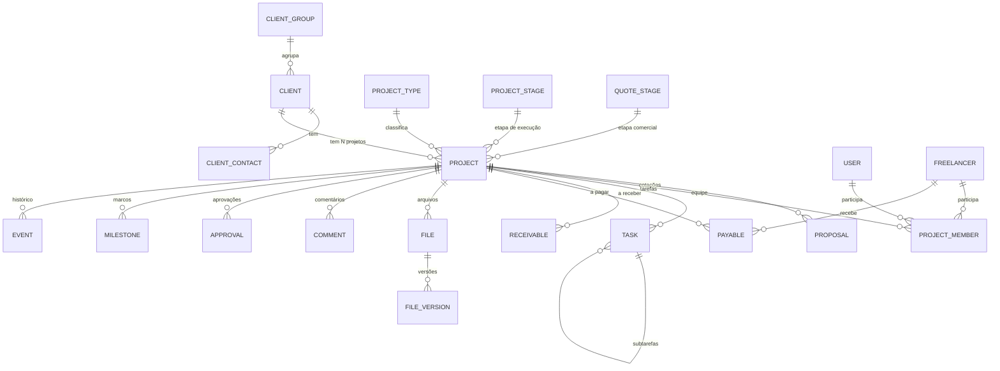

# Spec — Plataforma de Gestão Integrada (Draw)

> Documento de especificação para desenvolvimento orientado a spec (*spec-driven development*).
> Uso interno da equipe de produto e engenharia. Versão 0.4 · 22/11/2026.
>
> **Wiki viva do projeto.** Este arquivo mora no repositório (`docs/spec-plataforma-draw.md`) e é a referência fiel para quem
> constrói o back-end e o banco. Toda mudança de modelo, regra, etapa ou tela entra aqui **no mesmo commit** do código
> (Lei 11 do `CLAUDE.md`). Quando houver divergência, `src/data/types.ts` (modelo) e `src/data/services/*` (regras) são
> a implementação de referência e este documento deve ser corrigido.
>
> **Mudança da 0.2:** o sistema é feito de **módulos fixos** com o **projeto no centro**. Não existem quadros, colunas, campos ou automações criados pelo usuário (o modelo "Monday"). Processos, etapas e regras são definidos e testados no código.
>
> **Mudança da 0.3:** novo módulo **M11 — E-mail** (bônus): SMTP próprio da Draw configurável pelo admin e envio de e-mails de dentro do sistema com a conta de quem está logado, registrados no projeto. Login com Google entra como opcional **[A DECIDIR]**. Agenda Google sincronizada fica no futuro, com o requisito de verificação do Google documentado. A V2 passa a se chamar **Draw Case Room**.

> **Mudança da 0.4:** navegação em dois níveis ligados (seções no rail → itens no painel recolhível); visualizações de tarefas lista/kanban/calendário/Gantt em todos os lugares (RF-X-06). Front-end implementado (Next.js, dados locais com seed) e **validado contra a operação real da
> Draw**: planilha master de controle de projetos, quadro "1. Casos", quadro de áreas internas e estrutura de pastas do
> Drive. Etapas oficiais definidas (sai o [A VALIDAR]); novos campos (tamanho, pausa, política de pagamento do cliente,
> cobrança adicional, alíquota da organização, área das tarefas internas, ID legado); módulo de Arquivos vira **Drive**;
> mapeamento coluna a coluna da planilha → banco (seção 20); estado da implementação (seção 21).

>
> **Mudança da 0.5:** visualizações de tarefas em todos os lugares que listam tarefas — lista, kanban, calendário e Gantt (RF-X-06, RF-M4-17, RF-M6-06).
---

## 0. Como usar este documento

- Cada requisito tem um **ID estável** (`RF-…` funcional, `RN-…` regra de negócio, `RNF-…` não funcional, `ADR-…` decisão de arquitetura). Issues, PRs, testes e commits citam o ID.
- Requisitos têm **critérios de aceite**. Só está pronto quando todos passam em homologação.
- Releases: **R1** (primeira versão no ar, 20/12), **R2** (ajustes e go-live, janeiro), **Futuro** (seção 19).
- **[A VALIDAR]** depende da cliente. **[A DECIDIR]** depende de decisão técnica interna (seção 18).
- Mudança de escopo entra aqui primeiro, depois no código.

---

## 1. Visão

Plataforma web própria que substitui o Monday.com, as planilhas e a comunicação avulsa (WhatsApp, e-mail) da operação da Draw. **O projeto é o centro de tudo**: está sempre ligado a um cliente cadastrado, e comercial, execução, financeiro, arquivos, comunicação e indicadores se referem a ele. O banco é fortemente relacional para dar rastreio completo e permitir painéis ricos agora e no futuro.

### 1.1 Objetivos da V1

1. Centralizar a operação, com o projeto como prontuário completo e rastreável.
2. Visão consolidada para a gestão, sem trocar de tela.
3. Conectar Comercial → Projetos → Financeiro por regras de negócio no back-end.
4. Freelancers dentro da plataforma, vendo só o que é deles.
5. Indicadores gerados automaticamente a partir dos relacionamentos do banco.
6. Interface simples, limpa e rápida.

### 1.2 Não objetivos

- **Sem construtor de quadros, colunas, campos personalizados ou automações pelo usuário.** O escopo de módulos é fechado; evolução de processo é feita por desenvolvimento.
- **Sem IA, modelos preditivos ou LLM.** Todo indicador é determinístico.
- **Sem serviços cobrados por uso** quando houver alternativa no próprio servidor ou em plano gratuito (ex.: e-mail via Brevo/Resend, ADR-008).
- Sem portal do cliente e ambientes jurídicos na V1 (seção 19), mas com o modelo de dados pronto para eles.
- Sem app nativo nem publicação em lojas: o "app" é a própria plataforma instalada como **PWA** (RF-X-04).

---

## 2. Glossário

| Termo | Definição |
|---|---|
| **Organização** | Tenant da plataforma. Na V1 existe uma: a Draw. |
| **Módulo** | Parte fixa do sistema: Comercial, Projetos, Financeiro, Administrativo, Cadastros, Painel. |
| **Cliente** | Empresa atendida. Obrigatório em todo projeto. Pode pertencer a um grupo econômico e ter vários projetos. |
| **Projeto** | Unidade central de trabalho. **Na operação a equipe chama de "caso"** (quadro "1. Casos", planilha "Status Caso"); na plataforma o termo é Projeto. Código legível por tipo, ex.: `MEM-031`. |
| **Projeto interno** | Iniciativa da própria Draw (ex.: "Draw The Case Room"). Não tem cliente: é uma tarefa do módulo Administrativo na área `projetos_internos`. |
| **Área interna** | Agrupamento das tarefas internas: Administrativo, Comercial e Marketing, Projetos (internos), Financeiro, Outros. |
| **Drive** | Área de arquivos em pastas, seguindo a estrutura de pastas da Draw (seção 6.5). |
| **Pausado ("caso parado")** | Projeto ativo temporariamente parado (ex.: aguardando cliente). Não muda a etapa e sai dos alertas de prazo. |
| **Cobrança adicional** | Valor extra cobrado do cliente além do contratado (recebível do tipo `adicional`). |
| **Origem do projeto** | `cotacao` (nasce no Comercial e vira ativo ao aprovar a proposta) ou `direto` (nasce já aprovado, com financeiro preenchido). |
| **Tipo de projeto** | Item de catálogo (memorial jurídico, apresentação, contrato visual…). Define prefixo do código e modelo de tarefas. Mantido pelo admin. |
| **Etapa** | Fase fixa do processo (comercial ou de execução), definida no código. As colunas do kanban são as etapas. |
| **Proposta** | Cotação de um projeto, versionada. |
| **Tarefa** | Trabalho com responsável e prazo. Pertence a um projeto, ou ao módulo Administrativo. Pode ter subtarefas. |
| **Freelancer (prestador)** | Profissional externo alocado em projetos. |
| **Conta a receber** | Valor a faturar/receber do cliente, sempre ligado a um projeto. |
| **Conta a pagar** | Valor a pagar a um freelancer ou outro custo, sempre ligado a um projeto (exceto despesas administrativas). |
| **Evento** | Registro imutável de algo que aconteceu. Base do histórico, das métricas e das automações. |

---

## 3. Perfis

Perfis são **fixos** (definidos no código). O admin atribui um perfil a cada usuário e dá acesso a projetos.

| Perfil | Quem | Escopo |
|---|---|---|
| `admin` | Paula (CEO) | Tudo, incluindo configurações, valores, aprovações e cofre. |
| `gestao` | Beatriz | Comercial, Projetos, Administrativo; financeiro conforme definição **[A VALIDAR]**. |
| `comercial` | Quem conduz propostas | Comercial, clientes, leitura de projetos e faturamento relacionados. |
| `financeiro` | Responsável financeiro | Financeiro completo e leitura de projetos e clientes. |
| `operacao` | Equipe interna | Projetos e tarefas em que atua; sem valores. |
| `freelancer` | Designers, roteiristas, advogados | Só projetos em que está alocado; sem valores de terceiros, propostas ou faturamento. |
| `cliente` (futuro) | Usuários do cliente | Só projetos do próprio cliente. Previsto no modelo (`user_type = client`). |

Carga de referência: ~8 usuários no lançamento, ~20 simultâneos como teto de dimensionamento, ~100 freelancers e ~200 clientes cadastrados.

---

## 4. Princípios de arquitetura

| # | Princípio | O que fazer na V1 | O que isso destrava depois |
|---|---|---|---|
| P1 | **Projeto no centro** | Toda entidade operacional tem `project_id` (FK obrigatória quando aplicável). Telas de módulos são visões de projetos, nunca cópias. | Portal do cliente, ambientes e painéis leem o mesmo projeto. |
| P2 | **Cliente obrigatório e reutilizável** | `projects.client_id NOT NULL`. Cliente com grupo econômico e contatos. Um cliente, N projetos. | Área do cliente com acesso a todos os projetos dele, sem migração. |
| P3 | **Modelo relacional forte** | Chaves estrangeiras, `NOT NULL`, `CHECK` e índices em tudo que relaciona projeto, cliente, pessoa e dinheiro. Nada de dados de negócio em `jsonb` livre. | Dashboards confiáveis com SQL simples; integridade garantida pelo banco. |
| P4 | **Processo fixo, versionado no código** | Etapas e status em **tabelas de referência semeadas por migração** (`project_stages`, `quote_stages`), somente leitura para usuários. Mudar processo = migração + deploy. | Indicadores comparáveis no tempo; sem "colunas quebradas". |
| P5 | **Regras no back-end, nunca no usuário** | Automações (aprovação → financeiro, conclusão → pedido de NF) são serviços de domínio testados, disparados por eventos. Não existe construtor de automações. | Novas regras entram com teste e sem risco de quebrar fluxo. |
| P6 | **Multi-tenant desde o dia 1** | `organization_id` em toda tabela de domínio; políticas de **Row Level Security** escritas. | Isolamento de clientes nos ambientes da V2. |
| P7 | **Tipos de usuário e acesso por projeto** | `users.user_type ∈ {internal, freelancer, client}`; acesso a projeto por `project_members`; perfis fixos com matriz de permissões em **um único módulo de autorização** no back-end, com testes. | Usuários do cliente entram com o mesmo login e o mesmo motor. |
| P8 | **Event log de domínio** | Tabela `events` append-only para toda mudança relevante (quem, quando, antes/depois). Histórico, auditoria, notificações e métricas derivam dela. | Novas métricas sem reprocessar; webhooks futuros. |
| P9 | **Arquivos com versão e hash** | Abstração `StorageDriver` (disco local agora, S3-compatível depois); cada versão com `sha256`. | Prova de integridade da entrega na V2. |
| P10 | **Contrato de API primeiro** | OpenAPI antes do back-end; front com mocks (MSW). | Back-end escolhido depois sem travar o front. |
| P11 | **Jobs em fila no Postgres** | E-mails, importações, recálculo de métricas, lembretes. | Relatórios automáticos e NPS futuros sem infra nova. |
| P12 | **Links de compartilhamento genéricos** | `share_links` (token, expiração, senha opcional), já usado no formulário de NF do freelancer. | Publicação de memoriais com senha e expiração (V2). |
| P13 | **Módulos ligáveis** | `feature_flags` por organização para módulos futuros. | Portal, ambientes, marketing e horas entram desligados. |
| P14 | **Convenções** | IDs `uuid` v7; `created_at/updated_at/created_by`; *soft delete*; dinheiro em centavos (`bigint`); datas em UTC, exibidas em `America/Sao_Paulo`. | Consistência para relatórios e integrações. |

---

## 5. Stack

| Camada | Escolha |
|---|---|
| Front-end | **Next.js 15 (App Router) + React 19 + TypeScript** — decidido na implementação (ADR-011). Páginas são client components; nada de regra de negócio em server components |
| Roteamento / dados | App Router + TanStack Query (hooks em `src/data/hooks.ts`) |
| UI | **Tailwind CSS + shadcn/ui** (Radix), ícones lucide |
| Formulários | react-hook-form + zod (alinhado ao OpenAPI) |
| Drag-and-drop | dnd-kit (mudar etapa, reordenar prioridade) |
| Gráficos | Recharts (padrão shadcn charts) |
| Gantt | Componente próprio sobre a grade de datas **[A DECIDIR — ADR-004]** |
| PWA | `vite-plugin-pwa` (Workbox): manifest, service worker, prompt de atualização |
| Mocks | MSW gerado do OpenAPI |
| Testes front | Vitest + Testing Library; Playwright (E2E) |
| Banco | **PostgreSQL 16+** (`pgcrypto`, `citext`, `pg_trgm`, `unaccent`) |
| Back-end | **[A DECIDIR — ADR-001]**. Candidato: Node.js (Fastify ou NestJS) + ORM tipado. Requisitos na seção 11. |
| Fila | No Postgres (ex.: pg-boss) |
| E-mail | **Brevo** (principal) e **Resend** (reserva), nos planos gratuitos, atrás da abstração `MailTransport` (RNF-12); templates compatíveis com Gmail e Outlook |
| Infra | Front: **Cloudflare Workers** via OpenNext (ADR-012). Back-end: VPS + Docker Compose, proxy reverso com TLS; homologação e produção separadas |

---

## 6. Modelo de dados

> Nomes em inglês no banco; rótulos em português na interface. Toda tabela de domínio tem `id uuid`, `organization_id`, `created_at`, `updated_at`, `created_by`, `deleted_at`.

### 6.1 Identidade e acesso

| Tabela | Campos principais |
|---|---|
| `organizations` | `name`, `slug`, `settings jsonb` (somente parâmetros técnicos): `freelancer_payment_day` (20), `due_soon_days` (2), `tax_rate_pct` (6 — alíquota sobre faturamento usada na planilha) |
| `users` | `email citext unique`, `name`, `user_type` (`internal`/`freelancer`/`client`), `role` (enum fixo), `password_hash` (argon2id), `mfa_secret` (cifrado), `status`, `last_login_at` |
| `sessions` | sessões (cookie httpOnly) |
| `project_members` | `project_id`, `user_id` **ou** `freelancer_id`, `member_role` (`responsavel`/`designer`/`roteirista`/`advogado`/`apoio`), `agreed_amount_cents` (só para freelancer), `active` |
| `feature_flags` | `organization_id`, `key`, `enabled` |
| `access_logs` | login, falhas, revelações de segredo, acessos sensíveis |

### 6.2 Cadastros

| Tabela | Campos principais |
|---|---|
| `client_groups` | `name` |
| `clients` | `group_id` (nulo), `legal_name`, `trade_name`, `cnpj` (único por organização, validado), `address` (colunas próprias), `segment`, `status`, `notes`, `payment_terms_note` (texto, ex.: "20 dias após emissão da NF"), `payment_term_days` (int, nulo) |
| `client_contacts` | `client_id`, `name`, `email`, `phone`, `job_title`, `is_billing_contact`, `is_decision_maker` |
| `freelancers` | `user_id` (nulo até ter login), `name`, `email`, `phone`, `legal_name`, `document` (CPF/CNPJ, cifrado), `pix_key` (cifrado), `bank_*` (cifrados), `status`, `notes` |
| `freelancer_specialties` | `freelancer_id`, `specialty` (enum: `design`/`roteiro`/`juridico`/`outro`) |
| `project_types` | `name`, `code_prefix` (único), `description`, `active`. **Catálogo mantido pelo admin.** |
| `project_type_task_templates` | `project_type_id`, `stage_key`, `title`, `order`, `default_duration_days` |

### 6.3 Processo (tabelas de referência, semeadas por migração)

| Tabela | Conteúdo inicial |
|---|---|
| `quote_stages` | `entrada` ("Possíveis casos"), `diagnostico`, `elaboracao` ("A fazer proposta"), `enviada`, `negociacao`, `aprovada`, `perdida` |
| `project_stages` | `roteiro`, `ajustes_roteiro`, `design`, `ajustes_design`, `validacao_cliente` ("Com cliente para validação"), `concluido` — **oficiais**, espelham o quadro "1. Casos" da Draw (22/11/2026). O projeto aprovado entra em `roteiro` |
| `adm_areas` | `administrativo`, `comercial_marketing`, `projetos_internos`, `financeiro`, `outros` (quadro "Visão geral da empresa") |
| `project_sizes` | `pequeno`, `medio`, `grande` (planilha: Tamanho) |
| `payment_conditions` | `a_vista`, `50_50`, `parcelado` (planilha: Condição de Pagamento) |
| `task_statuses` | `a_fazer`, `em_andamento`, `em_revisao`, `concluida` |
| `priorities` | `baixa`, `media`, `alta`, `urgente` |

Cada linha tem `key`, `label`, `order`, `category` (`open`/`waiting`/`done`/`lost`). Usuários não editam essas tabelas.

### 6.4 Projetos e trabalho

| Tabela | Campos principais |
|---|---|
| `projects` | `client_id` **NOT NULL**, `project_type_id` **NOT NULL**, `code` (único; RN-05), `title`, `briefing`, `origin` (`cotacao`/`direto`), `status` (`cotacao`/`ativo`/`concluido`/`arquivado`/`perdido`/`cancelado`), `quote_stage_key` (quando `cotacao`), `project_stage_key` (quando `ativo`), `priority_key`, `owner_id`, `billing_contact_id`, datas: `entered_at`, `quote_sent_at`, `approved_at`, `started_at`, `due_at`, `estimated_end_at`, `completed_at`, `archived_at`; `contracted_amount_cents`, `lost_reason`, `is_environment` (futuro, default `false`), `size` (ref. `project_sizes`, nulo), `payment_condition` (nulo), `paused_at` + `paused_reason` ("caso parado"), `legacy_code` (ID da planilha, ex.: `P001`, único por organização quando presente — chave da importação) |
| `proposals` | `project_id`, `version`, `amount_cents`, `payment_terms` (parcelas: tabela `proposal_installments`), `status` (`rascunho`/`enviada`/`aprovada`/`recusada`), `sent_at`, `approved_at`, `file_id` |
| `proposal_installments` | `proposal_id`, `number`, `amount_cents`, `due_rule` ou `due_at` |
| `tasks` | `project_id` (nulo só para tarefas do módulo Administrativo), `module` (`projeto`/`adm`), `parent_task_id`, `stage_key` (etapa do projeto a que pertence), `title`, `description`, `assignee_user_id` ou `assignee_freelancer_id`, `status_key`, `priority_key`, `start_at`, `due_at`, `estimate_minutes`, `position` (fractional index), `sprint_id`, `completed_at`, `area` (ref. `adm_areas`; só quando `module = adm`) |
| `sprints` | `name`, `start_at`, `end_at`, `status` (módulo Administrativo) |
| `milestones` | `project_id`, `title`, `date`, `learning` |
| `project_deliverable_metrics` | `project_id`, `metric` (enum fixo: `paginas_antes`, `paginas_depois`, `tempo_leitura_antes`, `tempo_leitura_depois`…), `value` **[A VALIDAR lista]** |

### 6.5 Colaboração e arquivos

| Tabela | Campos principais |
|---|---|
| `comments` | `project_id`, `task_id` (nulo), `author_id`, `body`, `mentions uuid[]` |
| `approvals` | `project_id`, `stage_key`, `requested_from`, `decision` (`aprovado`/`ajustes`/`negado`), `reason`, `decided_by`, `decided_at` |
| `folders` | `parent_id` (nulo = raiz), `name`, `system_key` (raízes fixas), `allowed_roles role[]` (vazio = todos os internos), `order`. Raízes semeadas: `01. Projetos`, `02. Vendas`, `03. Financeiro` (admin/gestão/financeiro), `04. Adm & Operacional`, `05. Marketing`, `06. Design`, `07. Cérebro Draw`, `08. Cérebro Paula` (só admin), `10. Estratégia`, `11. Jurídico & RH`, `Eventos 2026`, `Planilha Projetos Marina e equipe`. Raízes não são renomeadas nem excluídas |
| `files` | `project_id` (ou `client_id`, ou `module = adm`), `folder_id` (nulo para arquivos de projeto), `task_id` (nulo), `category` (`entrega`/`briefing`/`marca_cliente`/`proposta`/`nf`/`institucional`/`outro`), `name`, `current_version_id`, `released_to_freelancers`. **Em `01. Projetos` as pastas são virtuais**: `<Cliente>/<Código — Título>` montadas pelos relacionamentos (arquivo continua ligado ao projeto — P1) |
| `file_versions` | `file_id`, `version`, `storage_key`, `size`, `mime`, `sha256`, `uploaded_by`, `note` |
| `share_links` | `token_hash`, `purpose` (`nf_freelancer`, futuro: `entrega`), `project_id`, `target_id`, `expires_at`, `password_hash`, `max_uses`, `use_count`, `revoked_at` |

### 6.6 Financeiro (sempre por projeto)

| Tabela | Campos principais |
|---|---|
| `receivables` | `project_id` **NOT NULL**, `client_id`, `proposal_installment_id` (nulo em projeto direto ou adicional), `kind` (`parcela`/`adicional`), `description`, `amount_cents`, `tax_cents` (= `amount × tax_rate_pct`), `expected_at`, `invoice_number`, `invoice_file_id`, `issued_at`, `received_at`, `status` (`previsto`/`faturado`/`recebido`/`vencido`/`cancelado`), `collection_note` (comentário de cobrança) |
| `payables` | `project_id` (nulo só em despesa administrativa), `kind` (`freelancer`/`despesa_projeto`/`despesa_adm`), `freelancer_id`, `project_member_id`, `description`, `agreed_amount_cents`, `invoiced_amount_cents`, `invoice_file_id`, `due_at`, `paid_at`, `status` (`aguardando_nf`/`em_conferencia`/`divergente`/`aprovado`/`pago`), `divergence_note` |
| `freelancer_invoice_requests` | `payable_id`, `share_link_id`, `sent_at`, `submitted_at`, dados declarados (colunas) |
| `v_project_financials` (view) | por projeto: contratado, previsto, faturado, recebido, a receber, custo com freelancers, outras despesas, **margem** e **margem %** |

### 6.7 Administrativo

| Tabela | Campos principais |
|---|---|
| `institutional_documents` | `title`, `category`, `file_id`, `valid_until` |
| `vault_items` | `title`, `url`, `username`, `secret` (cifrado), `notes` (cifrado), `allowed_roles` |
| `vault_access_logs` | `vault_item_id`, `user_id`, `action`, `at` |
| `resources` | `title`, `url`, `category` (enum fixo), `description` |

### 6.8 Plataforma

| Tabela | Campos principais |
|---|---|
| `events` | `entity_type`, `entity_id`, `project_id`, `client_id` (desnormalizados para consulta), `actor_id`, `type` (ex.: `project.stage_changed`), `data jsonb` (antes/depois), `occurred_at`. **Append-only.** |
| `notifications` | `user_id`, `type`, `project_id`, `entity_type`, `entity_id`, `title`, `read_at` |
| `notification_preferences` | `user_id`, `type`, `channel`, `enabled` |
| `imports` | `kind`, `source_file_id`, `status`, `mapping jsonb`, `report jsonb`, `dry_run` |
| `email_logs` | `channel` (`system`/`user`), `provider` (`brevo`/`resend`/`draw_smtp`/`gmail_api`/`user_smtp`), `user_id` (quando `user`), `project_id` (nulo para e-mails do sistema sem projeto), `provider_message_id`, `to`, `cc`, `subject`, `template`, `status` (`queued`/`sent`/`delivered`/`bounced`/`complained`/`failed`), `error`, `sent_at` |
| `email_provider_usage` | `provider`, `date`, `sent_count` (base do limite diário e do fallback) |
| `system_mail_settings` | `transport` (`brevo_resend`/`draw_smtp`), `smtp_host`, `smtp_port`, `smtp_security`, `smtp_user`, `smtp_password` (cifrado), `from_name`, `from_address` — um registro por organização |
| `mail_accounts` | `user_id`, `kind` (`gmail_oauth`/`smtp`), `address`, `display_name`, `oauth_refresh_token` (cifrado) ou `smtp_host`, `smtp_port`, `smtp_security`, `smtp_user`, `smtp_password` (cifrado), `status` (`connected`/`error`/`expired`), `last_checked_at` |
| `mail_signatures` | `user_id`, `html`, `updated_at` |
| `project_emails` | `project_id`, `email_log_id`, `sender_user_id`, `body_html`, `attachments` (lista de `file_version_id`) |

### 6.9 Integridade obrigatória (exemplos de `CHECK`/regras no banco)

- `projects.status = 'ativo'` exige `approved_at` e `contracted_amount_cents`.
- `projects.status = 'cotacao'` exige `quote_stage_key`; `ativo` exige `project_stage_key`.
- `receivables.project_id` obrigatório; `receivables.client_id` igual ao cliente do projeto (garantido por trigger ou FK composta).
- `payables.kind = 'freelancer'` exige `freelancer_id` e `project_member_id` do mesmo projeto.
- `project_members` exige exatamente um entre `user_id` e `freelancer_id`.

---

## 7. Requisitos funcionais (V1)

### M1 — Usuários e acesso

| ID | Requisito | Release |
|---|---|---|
| RF-M1-01 | Login por e-mail e senha, sessão por cookie httpOnly, recuperação de senha. | R1 |
| RF-M1-02 | Convite por e-mail com perfil definido; o convidado cria a senha. | R1 |
| RF-M1-03 | Listar, editar perfil e inativar usuários (sem apagar histórico). | R1 |
| RF-M1-04 | Autorização centralizada no back-end (P7) aplicada em todas as rotas; o front só reflete. | R1 |
| RF-M1-05 | Campos de valor removidos da resposta da API para perfis sem permissão. | R1 |
| RF-M1-06 | 2FA (TOTP), obrigatório para `admin`. | R2 |

Aceite: freelancer que pede um projeto em que não está alocado recebe `404`; usuário `operacao` nunca recebe campos de valor no JSON.

### M2 — Cadastros

| ID | Requisito | Release |
|---|---|---|
| RF-M2-01 | Clientes com CNPJ validado e único; grupo econômico; contatos (faturamento, decisor). | R1 |
| RF-M2-02 | Ficha do cliente: todos os projetos, propostas, recebíveis e indicadores do cliente (conforme permissão). | R1 |
| RF-M2-03 | Ao escolher o cliente no projeto, trazer CNPJ, razão social e contato de faturamento. | R1 |
| RF-M2-04 | Freelancers com especialidades, dados fiscais e bancários cifrados; ficha com projetos, entregas, pagamentos e carga atual. | R1 |
| RF-M2-05 | Catálogo de tipos de projeto (admin): nome, prefixo, modelo de tarefas por etapa. | R1 |
| RF-M2-06 | Consulta pública de CNPJ para preencher cadastro **[A DECIDIR fonte sem custo por uso]**. | R2 |

### M3 — Comercial

| ID | Requisito | Release |
|---|---|---|
| RF-M3-01 | Funil de projetos em cotação por etapa fixa (`quote_stages`), em kanban e lista. | R1 |
| RF-M3-02 | Criar projeto em cotação: cliente (obrigatório; cadastrar na hora se novo), tipo, título, responsável. | R1 |
| RF-M3-03 | Tarefas da cotação com prazo e responsável (ex.: elaborar proposta). | R1 |
| RF-M3-04 | Propostas versionadas com valor, parcelas e arquivo; datas de envio e aprovação registradas pelo sistema. | R1 |
| RF-M3-05 | Aprovar proposta dispara RN-01; perder exige motivo. | R1 |
| RF-M3-06 | Filtros por etapa, cliente, responsável, tipo e período. | R1 |

### M4 — Projetos

| ID | Requisito | Release |
|---|---|---|
| RF-M4-01 | **Criar projeto direto** (origem `direto`): cliente, tipo, título, valor contratado, parcelas a receber, equipe e prazo; entra como `ativo` e gera recebíveis (RN-02). | R1 |
| RF-M4-02 | Projetos ativos por etapa fixa (`project_stages`) em **kanban** e **lista**; **calendário** e **Gantt** na R2. | R1 / R2 |
| RF-M4-03 | Cartão do projeto: código, cliente, título, prioridade, prazo, equipe, progresso de subtarefas, atraso, status de aprovação e faturamento. | R1 |
| RF-M4-04 | Página do projeto (prontuário), abas: Visão geral · Tarefas · Equipe · Arquivos · Comentários · Aprovações · Financeiro · E-mails (R2, M11) · Histórico. | R1 |
| RF-M4-05 | Ao ativar, gerar tarefas a partir do modelo do tipo de projeto, por etapa. | R1 |
| RF-M4-06 | Tarefas e subtarefas com responsável (interno ou freelancer), prazo, prioridade, status, estimativa. | R1 |
| RF-M4-07 | Prioridade manual por arrastar dentro da etapa. | R1 |
| RF-M4-08 | "Minhas tarefas": atrasadas, hoje, esta semana, depois. | R1 |
| RF-M4-09 | Filtro por pessoa, cliente, tipo e prazo. | R1 |
| RF-M4-10 | Aprovações por etapa; "ajustes" e "negado" exigem motivo **[A VALIDAR]**. | R1 |
| RF-M4-11 | Materiais de apoio liberados ao freelancer (manual de marca do cliente, tom de voz…). | R1 |
| RF-M4-12 | Concluir projeto dispara RN-03; arquivar mantém tudo (RN-07). | R1 |
| RF-M4-13 | Alertas de prazo próximo (padrão 2 dias) e atraso. | R1 |
| RF-M4-17 | Aba **Tarefas** do prontuário e **Minhas tarefas** nas visões lista, kanban por status, calendário e Gantt (RF-X-06). | R1 |
| RF-M4-14 | Marcos e aprendizados; métricas de entrega (`project_deliverable_metrics`). | R2 |
| RF-M4-15 | Pausar/retomar projeto (RN-13) com motivo; selo "Parado" em cartões, linhas e prontuário; filtro "Situação". Tamanho (P/M/G) e condição de pagamento no prontuário e no assistente — "À vista" gera 1 parcela, "50/50" gera 2 (na aprovação / na entrega). | R1 |
| RF-M4-16 | Cobrança adicional pelo prontuário (RN-14) e comentário de cobrança por recebível; ao emitir NF, sugerir vencimento pelo prazo do cliente (`payment_term_days`). | R1 |

### M5 — Financeiro

| ID | Requisito | Release |
|---|---|---|
| RF-M5-01 | Contas a receber geradas por RN-01/RN-02, sempre ligadas ao projeto. | R1 |
| RF-M5-02 | Emissão de NF (número, arquivo, data) e baixa de recebimento. | R1 |
| RF-M5-03 | Contas a pagar a freelancers por RN-03; despesas de projeto e administrativas lançadas manualmente. | R1 |
| RF-M5-04 | Formulário público (via `share_links`) para o freelancer enviar NF e confirmar dados de pagamento. | R1 |
| RF-M5-05 | Conferência valor acordado × valor da NF (RN-04). | R1 |
| RF-M5-06 | **Financeiro do projeto:** contratado, faturado, recebido, custos e margem (`v_project_financials`). | R1 |
| RF-M5-07 | Visões consolidadas: a receber, a pagar, por mês, por cliente, por tipo de projeto. | R1 |
| RF-M5-08 | Importação e exportação de planilha (XLSX/CSV) com pré-visualização e relatório de erros. | R1 |

### M6 — Administrativo

| ID | Requisito | Release |
|---|---|---|
| RF-M6-01 | Tarefas internas (`module = adm`) com backlog e sprints. | R2 |
| RF-M6-02 | Documentos institucionais com validade e alerta. | R2 |
| RF-M6-03 | Cofre de credenciais cifrado, com log de revelação. | R2 |
| RF-M6-04 | Biblioteca de recursos (ferramentas, templates, playbooks). | R2 |
| RF-M6-05 | **Quadro por área** (visão padrão de `/adm/tarefas`): colunas 2. Administrativo · 3. Comercial e Marketing · 4. Projetos · 5. Financeiro · 6. Outros; arrastar muda `tasks.area`; adição rápida por coluna. | R1 |
| RF-M6-06 | `/adm/tarefas` com seletor de visão (lista · kanban · calendário · Gantt) aplicado à aba ativa — Por área (kanban = quadro de áreas), Sprint atual e Backlog (kanban por status); a aba Sprints não tem visão de tarefas (RF-X-06). | R1 |

### M7 — Arquivos

| ID | Requisito | Release |
|---|---|---|
| RF-M7-01 | Upload múltiplo por arrastar; limite por arquivo **[A VALIDAR]**. | R1 |
| RF-M7-02 | Versões com `sha256`; anteriores preservadas. | R1 |
| RF-M7-03 | Biblioteca por projeto e por cliente, com categorias e busca. | R2 |
| RF-M7-04 | Download por permissão, com link assinado de curta duração. | R1 |
| RF-M7-05 | **Drive** em `/arquivos?pasta=<id>` seguindo a estrutura de pastas da Draw (01. Projetos … Planilha Projetos Marina e equipe): árvore lateral, breadcrumb, grade/lista, busca na pasta, nova pasta, renomear, excluir (só vazia), enviar por arrastar e "Mover para…". Em 01. Projetos as pastas são virtuais por cliente (`cli:<id>`) e projeto (`prj:<id>`); os arquivos do projeto continuam ligados ao projeto (aba Arquivos do prontuário). Freelancer só vê 01. Projetos. | R1 |

### M8 — Painel e indicadores

| ID | Requisito | Release |
|---|---|---|
| RF-M8-01 | Painel da gestão: projetos por etapa, atrasos, entregas da semana, cotações abertas, a receber e a pagar do mês. | R2 |
| RF-M8-02 | Atividade do time por pessoa. | R2 |
| RF-M8-03 | Indicadores da seção 12, com período e exportação CSV. | R2 |
| RF-M8-04 | Carga por pessoa e por freelancer. | R2 |
| RF-M8-05 | Burndown por projeto. | R2 |
| RF-M8-06 | **Visão geral da empresa** no Início: casos · projetos internos · pendências (+ parados), como no quadro atual da Draw (`metrics.companyOverview`). | R1 |

### M9 — Área do freelancer

| ID | Requisito | Release |
|---|---|---|
| RF-M9-01 | Início: seus projetos e tarefas por prazo, com alertas. | R1 |
| RF-M9-02 | Atualizar status, comentar e enviar arquivos. | R1 |
| RF-M9-03 | Materiais liberados do projeto. | R1 |
| RF-M9-04 | Calendário pessoal; a gestão vê a disponibilidade de todos. | R2 |
| RF-M9-05 | Envio de NF e dados de pagamento ao fim do projeto. | R1 |

### M10 — Notificações

| ID | Requisito | Release |
|---|---|---|
| RF-M10-01 | No app: atribuição, menção, prazo, atraso, aprovação, NF solicitada/recebida. | R1 |
| RF-M10-02 | E-mail para os mesmos eventos, por preferência do usuário. | R1 |
| RF-M10-03 | Resumo diário por e-mail (opcional). | R2 |

### M11 — E-mail (bônus)

Dois usos distintos, que não se misturam:

- **E-mail do sistema** (notificações, convites, pedidos de NF): sai em nome da plataforma (ex.: `nao-responda@draw...`). Transporte padrão Brevo + Resend (RNF-12). O admin pode configurar o **SMTP próprio da Draw** como transporte principal, mantendo Brevo/Resend como reserva.
- **E-mail do usuário** (falar com cliente e freelancer a partir do projeto): sai **da caixa de quem está logado**, com a assinatura dele, e fica registrado no projeto.

| ID | Requisito | Release |
|---|---|---|
| RF-M11-01 | Tela de configuração de e-mail do sistema (admin): escolher transporte (Brevo/Resend padrão, ou SMTP próprio), host, porta, segurança (STARTTLS/SSL), usuário, senha (cifrada), remetente e botão "Enviar e-mail de teste". | R2 |
| RF-M11-02 | Cada usuário interno conecta a própria caixa em "Minha conta → E-mail": **Conectar com Google** (OAuth, escopo de envio do Gmail) ou **SMTP genérico** (host, porta, usuário, senha de app). Status visível (conectada, erro, expirada) e botão de teste. | R2 |
| RF-M11-03 | Escrever e-mail de dentro do projeto: destinatários sugeridos a partir dos contatos do cliente e da equipe; anexar arquivos do projeto (versão atual ou escolhida); modelos de e-mail (ex.: envio de proposta, entrega, pedido de aprovação). | R2 |
| RF-M11-04 | Assinatura HTML por usuário, compatível com Gmail e Outlook (texto + logo hospedado, sem imagem única), resolvendo os e-mails "desconfigurados" de hoje. | R2 |
| RF-M11-05 | Todo e-mail enviado pelo usuário fica no histórico do projeto (aba **E-mails** e linha do tempo), com remetente, destinatários, assunto, corpo, anexos (com versão) e data. Cópia também na pasta "Enviados" da caixa do usuário. | R2 |
| RF-M11-06 | Freelancers não usam M11 (não conectam caixa); continuam recebendo e-mails do sistema. | R2 |
| RF-M11-07 | Sem caixa conectada, a ação "Enviar e-mail" fica indisponível com orientação para conectar; nunca envia pelo transporte do sistema em nome do usuário. | R2 |

Fora do escopo do M11 na V1: **ler a caixa de entrada** dentro do sistema (cliente de e-mail completo). Respostas do cliente chegam normalmente na caixa do usuário. Ver seção 19.2.

### Transversais

| ID | Requisito | Release |
|---|---|---|
| RF-X-01 | Busca global (projetos, clientes, freelancers, tarefas). | R2 |
| RF-X-02 | Histórico de eventos em projeto, tarefa, proposta e lançamento financeiro. | R1 |
| RF-X-03 | Estados vazio, carregando e erro em todas as telas. | R1 |
| RF-X-04 | **PWA instalável** (bônus incluído na V1): manifest, ícones e service worker desde o primeiro deploy; instalável no Android, iPhone/iPad, Windows e macOS sem loja. Detalhes em 10.6. | R1 |
| RF-X-05 | **Responsivo** em computador, tablet e celular, com padrões de navegação próprios por faixa de tela (10.6). | R1 |
| RF-X-06 | **Visualizações de tarefas**: todo lugar que lista tarefas oferece as mesmas visões dos projetos — **lista**, **kanban** (por status; em Administrativo › Por área as colunas são as áreas), **calendário** (pelo prazo) e **Gantt** (início → prazo). Visão na URL (`?visao=`); tarefas sem data mostram o aviso "N tarefas sem data" com atalho para a lista; no celular a lista é a visão padrão, o kanban mostra uma coluna por vez, o calendário vira agenda e o Gantt rola na horizontal. Abrir a tarefa segue pelo peek (`?tarefa=`). Componente único `TaskViews`. Vale para Minhas tarefas, aba Tarefas do prontuário (M4), Administrativo (M6) e início do freelancer. | R1 |

---

## 8. Regras de negócio

| ID | Regra |
|---|---|
| RN-01 | **Proposta aprovada** → projeto passa de `cotacao` a `ativo` na primeira etapa de execução; `approved_at` e `contracted_amount_cents` preenchidos; recebíveis criados das parcelas; tarefas do modelo geradas. Uma transação; evento `proposal.approved`. |
| RN-02 | **Projeto direto** → criado já `ativo`; exige cliente, valor contratado e ao menos uma parcela; recebíveis criados das parcelas informadas. |
| RN-03 | **Projeto concluído** → para cada freelancer com valor acordado, cria `payable` em `aguardando_nf`, gera `share_link` (30 dias) e envia e-mail. |
| RN-04 | NF do freelancer: valor diferente do acordado → `divergente` com nota; igual → `em_conferencia`. Aprovação manual → `aprovado`. |
| RN-05 | Código do projeto: `{prefixo do tipo}-{sequencial de 3 dígitos}`, sequência por prefixo, nunca reutilizada. |
| RN-06 | Vencimento do pagamento ao freelancer: dia 20 do mês seguinte à conclusão **[A VALIDAR exceções]**; dia parametrizado em `organizations.settings`. |
| RN-07 | Arquivar não apaga; arquivados saem das visões ativas e seguem em busca e relatórios. |
| RN-08 | Freelancer vê só projetos com `project_members.active = true`; ao sair, perde acesso, mas seus registros permanecem. |
| RN-09 | Toda alteração de valor (proposta, contratado, recebível, pagável, acordado) gera evento com antes/depois. |
| RN-10 | Exclusões são *soft delete*; exclusão definitiva só por `admin`, registrada. |
| RN-11 | Datas de envio e aprovação de proposta são registradas pelo sistema, não digitadas. |
| RN-12 | Um projeto nunca troca de cliente depois de ter recebível emitido. |
| RN-13 | **Pausar projeto** exige motivo; só projetos `ativo`. Pausado não muda etapa, não conta como atrasado e aparece com selo "Parado"; retomar limpa `paused_at`/`paused_reason`. Eventos `project.paused` / `project.resumed`. |
| RN-14 | **Cobrança adicional** cria recebível `kind = adicional` ligado ao projeto, imposto pela alíquota da organização; não altera `contracted_amount_cents` (margem considera recebíveis adicionais à parte). |
| RN-15 | **Imposto** de recebível = `amount_cents × organizations.settings.tax_rate_pct / 100` (padrão 6%, como na planilha). |
| RN-16 | **Pastas**: raízes do sistema não são renomeadas/excluídas; pasta só é excluída vazia; arquivos de projeto não são movidos para fora do projeto; `allowed_roles` da pasta-mãe é herdado ao criar subpasta. |
| RN-17 | Drive (detalhe da RN-16): pastas-raiz da estrutura da Draw não são renomeadas nem excluídas; nome único por pasta-mãe; pasta só é excluída vazia; arquivo de projeto não é movido (fica na pasta do projeto); arquivos de mesmo nome em pastas diferentes são arquivos distintos (só viram versão dentro da mesma pasta ou projeto). |

---

## 9. Matriz de permissões (fixa)

**T** total · **L** leitura · **P** próprios/alocados · **—** sem acesso.

| Recurso | admin | gestao | comercial | financeiro | operacao | freelancer |
|---|---|---|---|---|---|---|
| Usuários e configurações | T | L | — | — | — | — |
| Clientes | T | T | T | L | L | — |
| Freelancers (cadastro) | T | T | L | T | L | P |
| Freelancers (dados bancários) | T | **[A VALIDAR]** | — | T | — | P |
| Projetos | T | T | T | L | P | P |
| Valores do projeto e propostas | T | **[A VALIDAR]** | T | T | — | — |
| Tarefas | T | T | T | L | P | P |
| Contas a receber | T | **[A VALIDAR]** | L | T | — | — |
| Contas a pagar | T | **[A VALIDAR]** | — | T | — | P |
| Arquivos do projeto | T | T | T | L | P | P (liberados) |
| Cofre | T | por item | por item | por item | por item | — |
| Indicadores | T | T | comerciais | financeiros | — | — |

---

## 10. Front-end

### 10.1 Direção visual

> **Atualizado na 0.4 (marca oficial):** identidade conforme o Brandbook Draw the Law — Roxo `#BD48D0`, Roxo escuro `#724AFF` (ações), Azul escuro `#071445` (marca, painel de login, splash, ícone do app), Azul ciano `#28ADEF`, Cinza `#DFDFDF`, Preto `#252525` (texto). Fonte única **Manrope**. Logotipo e símbolo oficiais em SVG (sem redesenho), cor sólida herdada do tema. Tema claro branco e limpo; tema escuro azul-violeta profundo (sem preto neutro). Botões em pílula sem brilho; gradientes roxo→ciano e roxo→roxo escuro apenas decorativos. Ao entrar, splash animada da marca (assinatura "escrita" pela caneta, ~1,7 s; estática com movimento reduzido). Tokens em `src/app/globals.css`.

- Estilo **shadcn/ui** neutro (zinc), raio 8–10px, sombras mínimas, Inter/Geist.
- Cor só com significado: status (âmbar aguardando, vermelho atraso, verde concluído, azul ativo) e tipo de projeto (ícone no cartão).
- Referência: `tela-kanban.png`.

### 10.2 Navegação (fixa, dois níveis ligados — atualizado na 0.4)

- **1º nível — rail de seções** (ícone + rótulo curto): Início · Projetos · Financeiro · Administrativo · Cadastros · Painel · Arquivos · (rodapé) Configurações. Clicar abre a página de entrada da seção **e troca o 2º nível**; a seção ativa vem da URL (`sectionOf`), com indicador lateral.
- **2º nível — painel da seção**: título da seção, **Busca (⌘K)**, **Novo projeto** (logo abaixo da busca), itens da seção (ex.: Projetos → Funil de cotações · Ativos · Concluídos; Painel → abas de indicadores) e menu do usuário. **Recolhível** (botão ou tecla `[`), preferência lembrada por pessoa.
- Celular: barra inferior (Início, Projetos, Tarefas, Entrada, Mais); "Mais" abre a gaveta com **todas** as seções empilhadas. Tablet: rail + gaveta.
- **Topo da página:** breadcrumb, seletor de visualização (lista, kanban, calendário, Gantt), filtros.
- Sem criação de quadros, colunas ou campos pela interface.
- Configuração única em `src/components/layout/nav-config.ts` (`SECTIONS`), filtrada pela matriz de permissões.

### 10.3 Rotas

| Rota | Tela |
|---|---|
| `/login`, `/recuperar-senha`, `/convite/:token` | Autenticação |
| `/` | Início (gestão ou freelancer) |
| `/minhas-tarefas`, `/caixa-de-entrada` | Pessoal |
| `/comercial` | Funil de cotações |
| `/projetos`, `/projetos/concluidos` | Projetos |
| `/projetos/novo` | Assistente: cotação ou projeto direto |
| `/projetos/:code` | Prontuário (abas do RF-M4-04) |
| `/financeiro/receber`, `/financeiro/pagar`, `/financeiro/visao-geral`, `/financeiro/importar` | Financeiro |
| `/adm/tarefas`, `/adm/documentos`, `/adm/cofre`, `/adm/recursos` | Administrativo |
| `/clientes`, `/clientes/:id` | Ficha do cliente com todos os projetos |
| `/freelancers`, `/freelancers/:id` | Ficha do freelancer |
| `/painel` | Indicadores (abas: Visão geral, Comercial, Operação, Financeiro, Equipe, Burndown) |
| `/configuracoes/usuarios`, `/configuracoes/tipos-de-projeto`, `/configuracoes/preferencias`, `/configuracoes/email` | Admin (inclui SMTP do sistema, RF-M11-01) |
| `/minha-conta/email` | Conectar caixa, assinatura (RF-M11-02, RF-M11-04) |
| `/nf/:token` | Formulário público de NF |
| `/arquivos` | **Drive** (`?pasta=<id>`; pastas virtuais `cli:<id>` e `prj:<id>` em 01. Projetos) |
| `/offline` | Página servida pelo service worker sem conexão |

> Rotas implementadas usam o mesmo caminho em pt-BR; filtros, abas (`?aba=`), visão (`?visao=`), painéis (`?tarefa=`, `?n=`) ficam na URL.

### 10.4 Componentes base

Cartão de projeto, cartão de tarefa, coluna de etapa, chips de status/prazo/prioridade, pilha de avatares, progresso de subtarefas, editor de texto simples, uploader com versões, linha do tempo de eventos, tabela com ordenação e paginação, seletor de período, gráficos, Gantt, painel lateral de detalhe, diálogo de confirmação, assistente de novo projeto (duas origens).

### 10.5 Qualidade

Teclado e foco visível, contraste AA, listas virtualizadas acima de 100 itens, atualização otimista ao mover cartões, *code splitting* por rota, textos em pt-BR centralizados.

### 10.6 Responsivo e PWA

**Faixas de tela**

| Faixa | Layout |
|---|---|
| ≥ 1280 px (computador) | Rail + sidebar + conteúdo, como na referência. |
| 768–1279 px (tablet) | Sidebar recolhível em gaveta; kanban com rolagem horizontal; prontuário em uma coluna com abas. |
| < 768 px (celular) | Barra de navegação inferior (Início, Projetos, Minhas tarefas, Caixa de entrada, Mais); **lista no lugar do kanban** por padrão (kanban opcional, uma coluna por vez); formulários em tela cheia; ações principais em botão flutuante. |

Regras gerais: alvos de toque de pelo menos 44 px; respeitar *safe areas* (notch e barra inferior do iPhone); nada depende de *hover*; tabelas largas viram cartões no celular; upload aceita câmera e galeria no celular.

**PWA (bônus da V1)**

| Item | Requisito |
|---|---|
| Manifest | `name`, `short_name`, `start_url: /`, `display: standalone`, `theme_color` e `background_color` da marca, ícones 192, 512 e *maskable*, `lang: pt-BR`. |
| iOS | `apple-touch-icon`, `apple-mobile-web-app-capable`, `status-bar-style`, telas de abertura. Como o iOS não mostra convite automático, tela de ajuda "Instalar no iPhone" (Safari → Compartilhar → Adicionar à Tela de Início). |
| Android e computador | Botão "Instalar app" usando o evento `beforeinstallprompt` (Chrome e Edge). |
| Service worker | Cache do *app shell* e dos arquivos estáticos (*precache*); API sempre pela rede (*network-first*, sem guardar dados sensíveis em cache); página "sem conexão" amigável. |
| Atualização | Ao publicar uma nova versão, aviso "Nova versão disponível — atualizar" (sem prender o usuário em versão antiga). |
| Offline | V1 não edita dados offline; mostra o último estado carregado apenas para leitura da tela aberta. |
| Notificações push | Preparar o service worker para Web Push (VAPID, sem custo); ativação fica para o futuro (no iPhone exige iOS 16.4+ e app instalado). |
| Segurança | Sessão continua por cookie httpOnly; logout limpa caches do usuário. |
| Aceite | Lighthouse PWA "instalável" aprovado; instalação testada em Android (Chrome), iPhone (Safari), Windows (Edge/Chrome) e macOS (Chrome/Safari). |

---

## 11. API (contrato primeiro)

- REST JSON em `/api/v1`; contrato em `openapi.yaml`; tipos gerados para front e back.
- Sessão por cookie httpOnly + CSRF **[ADR-002]**.
- Paginação por cursor; filtros por query string; erros RFC 9457; `Idempotency-Key` em aprovar proposta, criar projeto direto, concluir projeto e importar.
- Upload em duas etapas (pedir upload → enviar → confirmar).

Recursos: `auth`, `users`, `clients`, `client-groups`, `client-contacts`, `freelancers`, `project-types`, `reference` (etapas, status, prioridades — somente leitura), `projects`, `projects/:id/members`, `projects/:id/financials`, `proposals`, `tasks`, `sprints`, `comments`, `approvals`, `files`, `receivables`, `payables`, `imports`, `vault-items`, `resources`, `institutional-documents`, `notifications`, `events`, `metrics`, `search`, `public/freelancer-invoice/:token`.

| ID | Requisito para o back-end (qualquer tecnologia) |
|---|---|
| RNF-BE-01 | Implementar o `openapi.yaml`; testes de contrato no CI. |
| RNF-BE-02 | Migrações versionadas, incluindo a carga das tabelas de referência. |
| RNF-BE-03 | Serviços de domínio para RN-01 a RN-12, com testes unitários. |
| RNF-BE-04 | Fila de jobs no Postgres. |
| RNF-BE-05 | RLS em todas as tabelas com `organization_id`. |
| RNF-BE-06 | Logs estruturados com `request_id`. |

---

## 12. Indicadores

Todos calculados por SQL sobre os relacionamentos (P3), com *materialized views* atualizadas por job.

| Indicador | Fórmula |
|---|---|
| Tempo de conversão | mediana(`approved_at − quote_sent_at`) |
| Taxa de conversão | aprovadas ÷ enviadas, por tipo e por responsável |
| Origem dos projetos | % `cotacao` × `direto` |
| Tempo de ciclo | mediana(`completed_at − started_at`) por tipo |
| Prazo estimado × realizado | `completed_at − estimated_end_at`; % no prazo |
| Tempo por etapa e gargalo | tempo entre eventos `project.stage_changed` |
| Vazão | projetos concluídos por mês |
| Em andamento | projetos e tarefas abertos por etapa e pessoa |
| Carga por pessoa/freelancer | tarefas abertas e com prazo em 7 dias |
| % de atraso | itens vencidos ÷ abertos |
| Receita | contratado, faturado e recebido por mês, por cliente, por tipo |
| Margem | (contratado − custos) por projeto, cliente e tipo |
| Ticket médio | contratado médio por tipo e por cliente |
| Recorrência de clientes | clientes com mais de um projeto; projetos por cliente |
| Custo de freelancers | soma de `payables` freelancer por projeto e por freelancer |
| Burndown | subtarefas restantes por dia até `due_at` |

---

## 13. Importação e migração

1. Mapear antes de desenvolver: quadros do Monday, planilha de projetos/financeiro, lista de freelancers (coluna de origem → campo de destino).
2. Importadores idempotentes (chaves: código do projeto, CNPJ, e-mail), com *dry run*, pré-visualização e relatório por linha.
3. Ordem: usuários → clientes e contatos → freelancers → tipos de projeto → projetos (com origem) → propostas → tarefas abertas → financeiro em aberto → anexos relevantes.
4. Etapas do Monday mapeadas para as etapas fixas; o que não mapear vai para revisão manual.
5. Setup conjunto com a equipe; operação paralela curta.

---

## 14. Requisitos não funcionais

| ID | Requisito |
|---|---|
| RNF-01 | Senhas argon2id; bloqueio progressivo após falhas. |
| RNF-02 | HTTPS; CSP, HSTS e cabeçalhos de segurança. |
| RNF-03 | Dados sensíveis cifrados na aplicação, chave fora do banco. |
| RNF-04 | Auditoria via `events`; retenção mínima de 5 anos **[A VALIDAR]**. |
| RNF-05 | LGPD: finalidade, acesso mínimo, exportação e anonimização sob pedido. |
| RNF-06 | Backup diário do banco e dos arquivos, retenção de 30 dias, cópia fora do servidor **[A DECIDIR destino]**, teste de restauração mensal. |
| RNF-07 | p95 < 300 ms em listagens, < 150 ms em leitura de item, com 20 simultâneos; primeira carga < 2,5 s em 4G. |
| RNF-08 | Disponibilidade alvo 99,5% em horário comercial; monitoramento e alertas. |
| RNF-09 | Logs estruturados e rastreamento de erros *self-hosted* ou gratuito. |
| RNF-10 | Homologação nunca recebe dados de produção sem anonimizar. |
| RNF-11 | Navegadores: duas últimas versões de Chrome, Edge, Safari e Firefox. |
| RNF-12 | **E-mail por provedores externos, nos planos gratuitos** (o servidor não envia e-mail direto, para não expor o IP da VPS a listas de spam). `MailTransport` com dois adaptadores: **Brevo** (principal) e **Resend** (reserva). Regras: (a) contador diário de envios por provedor, persistido no banco; (b) ao atingir a cota gratuita do dia do Brevo, ou em erro 5xx/timeout, a fila envia pelo Resend; (c) se os dois estiverem na cota, o envio fica na fila para o dia seguinte e a gestão vê um aviso no painel; (d) reenvio com *backoff*; (e) notificações acumuladas de um mesmo usuário viram resumo. Prioridade na fila: convites e recuperação de senha > pedido de NF > notificações. Cotas configuradas por variável de ambiente **[confirmar cotas gratuitas atuais nos sites dos provedores]**. |
| RNF-13 | Entregabilidade: domínio da Draw autenticado nos dois provedores (SPF com os dois `include`, DKIM de cada provedor, DMARC); remetente fixo no domínio da Draw; webhooks de entrega e devolução (*bounce*/*complaint*) dos dois provedores registrados em `email_logs` (provedor, mensagem, status, data). |
| RNF-14 | **E-mail do usuário (M11):** credenciais (token OAuth ou senha SMTP) cifradas na aplicação, nunca expostas ao front; token renovado automaticamente e status "expirada" quando falhar; envio pela fila com limite por usuário abaixo do teto do provedor (Google Workspace: cerca de 2.000 mensagens/dia por usuário **[confirmar]**); remoção da conexão apaga as credenciais. |
| RNF-15 | **Gmail via OAuth:** preferir a API do Gmail com escopo só de envio a SMTP com senha de app (o Google restringe acesso por senha). Se a Draw usa Google Workspace, registrar o app como **Interno** ao domínio: dispensa a verificação do Google. Se a caixa for Microsoft 365/Outlook, a autenticação SMTP básica tende a estar desativada: usar OAuth (Microsoft Graph) **[A DECIDIR conforme o provedor da Draw]**. |

---

## 15. Infraestrutura

VPS (4 vCPU, 16 GB RAM, 200 GB NVMe, Brasil) com Docker Compose: `web`, `api`, `worker`, `postgres`, proxy reverso com TLS. Arquivos em volume local via `StorageDriver`. E-mail via Brevo (principal) e Resend (reserva), com SPF, DKIM e DMARC do domínio configurados nos dois (RNF-12, RNF-13); a VPS não envia e-mail diretamente. Em novembro o desenvolvimento é local; a VPS é contratada em dezembro para a homologação de 20/12. CI com lint, typecheck, testes e build; deploy automático em homologação, manual em produção.

---

## 16. Processo e qualidade

- **Definition of Done:** critérios de aceite atendidos; testes (unitário para regra de negócio, componente para UI crítica, E2E para fluxos principais); revisão de código; validado em homologação; spec atualizado.
- Conventional Commits; branches curtas; PR cita IDs; ADRs em `docs/adr/`.
- E2E obrigatórios: (1) cotação → proposta → aprovação → projeto ativo com recebíveis; (2) projeto direto → recebíveis; (3) concluir projeto → freelancer recebe link → envia NF → divergência detectada; (4) freelancer não acessa projeto alheio.

---

## 17. Plano de entregas

| Etapa | Período | Saída |
|---|---|---|
| Rodada de design | 19/11 – 28/11 | Protótipo navegável (shadcn/ui) |
| Avaliação e ajustes | 01/12 – 03/12 | Design aprovado |
| Desenvolvimento R1 | 04/12 – 20/12 | M1, M2, M3, M4 (kanban/lista), M5, M7 básico, M9, M10, responsivo e PWA instalável em homologação |
| Ajustes e R2 | 05/01 – 30/01 | M6, M7 completo, M8, M11 (e-mail, bônus), calendário e Gantt, 2FA, busca, migração, treinamento, go-live |

Ordem de construção do front (com mocks): layout e autenticação → cadastros → projetos (lista/kanban) → prontuário → novo projeto (duas origens) → comercial → financeiro → freelancer → notificações.

---

## 18. Decisões em aberto

| ID | Decisão | Status |
|---|---|---|
| ADR-001 | Tecnologia do back-end | A decidir |
| ADR-002 | Sessão por cookie × JWT | Recomendado: cookie httpOnly |
| ADR-003 | Fila no Postgres | Recomendado: pg-boss ou equivalente |
| ADR-004 | Gantt próprio × biblioteca | Após o design |
| ADR-005 | Fonte de CNPJ sem custo por uso | A decidir |
| ADR-006 | Destino do backup externo | A decidir |
| ADR-008 | Envio de e-mail do sistema | **Decidido:** Brevo (principal) + Resend (reserva), planos gratuitos; Amazon SES descartado por exigir cartão e não ser gratuito após 12 meses. SMTP próprio da Draw pode ser configurado como principal (RF-M11-01) |
| ADR-009 | E-mail do usuário: API do Gmail (OAuth) × SMTP com senha de app | Recomendado: API do Gmail com app Interno ao domínio da Draw; SMTP genérico como alternativa. Confirmar provedor de e-mail da Draw |
| ADR-010 | Login com Google (OAuth) | Opcional, sem custo; se entrar, app "Externo" (freelancers usam e-mail próprio) e login por e-mail/senha mantido |
| ADR-007 | Etapas como tabela de referência × enum do Postgres | Recomendado: tabela de referência semeada (permite rótulo e ordem sem migração de tipo) |
| ADR-011 | Framework do front | **Decidido:** Next.js 15 App Router (no lugar de Vite + TanStack Router), PWA com service worker próprio |
| ADR-012 | Hospedagem do front | **Decidido:** Cloudflare Workers via OpenNext (`wrangler.jsonc`, `docs/DEPLOY.md`) |
| ADR-013 | Arquivos | **Decidido:** Drive com estrutura de pastas da Draw; pastas de projeto virtuais (projeto continua dono do arquivo) |

Pendências com a cliente: ~~etapas oficiais~~ (definidas em 0.4); campos obrigatórios; emissor de NF; exceções da regra do dia 20; acessos financeiros por perfil; motivo obrigatório em aprovações; lista de métricas de entrega; escopo da importação; limites e retenção de arquivos.

---

## 19. Escopo futuro

> Fora da V1. A coluna "Base pronta na V1" indica o que já precisa existir para não haver retrabalho.

### 19.1 V2 — Draw Case Room (portal do cliente e ambientes jurídicos)

**Portal do cliente:** usuários do cliente acessam **todos os projetos do próprio cliente**; andamento em tempo real; histórico de produtos entregues com versões; documentos e comentários; aprovação formal de etapas; financeiro opcional por cliente e por usuário.

**Ambientes Jurídicos:** projeto marcado como ambiente ganha espaço isolado; administrador do cliente convida e gerencia usuários (admin do cliente, colaborador, leitor); memorial jurídico (peça de Design Law hoje entregue em front-end) publicado no ambiente; link com senha e expiração; registro de acessos; prova de integridade da versão entregue.

| Necessidade da V2 | Base pronta na V1 |
|---|---|
| Cliente vê todos os seus projetos | `projects.client_id NOT NULL` (P2) |
| Usuários do cliente | `users.user_type = client` (P7) |
| Acesso por projeto | `project_members` + autorização centralizada (P7) |
| Isolamento | `organization_id` + RLS (P6) |
| Projeto como ambiente | `projects.is_environment` + `feature_flags` (P13) |
| Publicação controlada | `share_links` (P12), `access_logs` |
| Prova de integridade | `file_versions.sha256` (P9) |
| Aprovação do cliente | `approvals` por projeto e etapa |
| Histórico | `events` por projeto e cliente (P8) |

### 19.2 Backlog (Fase 3)

Tudo no próprio servidor (ou em planos gratuitos, como o e-mail), por regras programadas, sem IA e sem serviços cobrados por uso.

| Ideia | Base pronta na V1 |
|---|---|
| Horas por tarefa e capacidade produtiva | `tasks.estimate_minutes`, eventos de status |
| Preço e prazo sugeridos pelo histórico do tipo de projeto | `projects`, `proposals`, `v_project_financials` |
| Catálogo de serviços e proposta em PDF por modelo | `project_types`, `proposals`, fila |
| Biblioteca de componentes de memoriais | `files` com categorias e versões |
| Métricas de Legal Design por entrega | `project_deliverable_metrics` |
| Avaliação interna de freelancers | `project_members`, `payables` |
| NPS ao concluir projeto | `share_links`, evento `project.completed`, fila |
| Relatório mensal automático | indicadores + fila + e-mail |
| Calendário editorial de marketing com aprovação | novo módulo atrás de `feature_flags`, `approvals` |
| Métricas de redes sociais | importadores, fila |
| Google Agenda sincronizada e Meet por projeto (reuniões, horas e custo). API gratuita; escopo de agenda é "sensível" e exige verificação do Google (gratuita, dias a semanas) se o app for Externo, ou nenhuma se for Interno ao domínio | `events`, `project_members`, OAuth do M11 |
| Caixa de entrada dentro do sistema (ler respostas e vinculá-las ao projeto). Leitura do Gmail é escopo "restrito": viável sem auditoria só com app Interno ao domínio | `mail_accounts`, `project_emails` (M11) |
| Notificações push no celular | service worker do PWA já preparado para Web Push (10.6) |
| Integração com emissor de NF / contabilidade | `receivables`, `payables` |
| Webhooks e API pública | `events`, OpenAPI |
| Longo prazo: IA | só com plataforma consolidada e histórico suficiente |

---

## 20. Operação atual da Draw → modelo (referência para migração)

Fontes analisadas em 22/11/2026:
- planilha **"Planilha Master | Controle de Projetos | 2026"**, com as abas Projetos & Pagamentos, Resumo Freelancers, Pagamentos Freelancers e uma aba por freelancer;
- quadros **"1. Casos"** e **"Visão geral da empresa"** (áreas 2 a 6);
- estrutura de pastas do Drive.

### 20.1 Quadro "1. Casos" → etapas

| Coluna do quadro | Onde fica na plataforma |
|---|---|
| Possíveis casos | `projects.status = cotacao`, `quote_stage = entrada` |
| A fazer proposta | `quote_stage = elaboracao` (proposta em rascunho) |
| Roteiro · Ajustes roteiro · Design · Ajustes de design · Com cliente para validação | `project_stages` homônimas (status `ativo`) |
| Casos concluídos | `status = concluido` (etapa `concluido`) |
| Checklist do cartão ("Concluídas · N") | Tarefas e subtarefas do projeto |

### 20.2 Quadro "Visão geral da empresa" → áreas internas

O cabeçalho do quadro mostra "16 casos · 5 projetos · 33 pendências". Na plataforma esses números vêm de `metrics.companyOverview`:
- **casos**: projetos ativos ou em cotação;
- **projetos**: tarefas internas abertas na área `projetos_internos`;
- **pendências**: tarefas internas abertas.

As colunas do quadro (2. Administrativo, 3. Comercial e Marketing, 4. Projetos, 5. Financeiro, 6. Outros) correspondem a `tasks.module = adm` agrupadas por `tasks.area`.

### 20.3 Planilha master — aba "Projetos & Pagamentos" (54 colunas)

| Coluna da planilha | Destino no banco | Observação |
|---|---|---|
| ID (P001) | `projects.legacy_code` | Chave idempotente da importação |
| PROJETO ("Leroy - BMB") | `projects.title` | Padrão "Cliente - Nome". Importar sem o prefixo do cliente quando ele for igual ao cliente |
| Cliente / CNPJ Cliente | `clients.trade_name` / `clients.cnpj` | O CNPJ vem com tabulação no fim: normalizar. A lista de validação traz os clientes atuais |
| Data Entrada / Mês de entrada | `projects.entered_at` | O mês é derivado (não armazenar) |
| Tamanho | `projects.size` | Pequeno / Médio / Grande |
| Tipo de Projeto ("Apresentação PPT") | `projects.project_type_id` | Mapear para o catálogo `project_types` |
| Link Proposta | `proposals.file_id` ou link | "Não encontrada" vira nulo |
| Valor Total (R$) | `projects.contracted_amount_cents` | Valor em reais × 100 |
| Imposto (R$) = 6% × Valor | `receivables.tax_cents` | Regra RN-15 |
| Data Emissão NF | `receivables.issued_at` | |
| Previsão / Data / Valor Pagto Parcela 1 e 2 | `receivables` (uma linha por parcela): `expected_at`, `received_at`, `amount_cents` | Condição "50/50" gera 2 parcelas; "À vista" gera 1 |
| Mês do pagamento | — | Derivado |
| Status Projeto (Caso Iniciando / Em Andamento / Caso Parado / Caso Finalizado) | `projects.status` + `paused_at` | Iniciando e Em Andamento → `ativo` (a etapa vem do quadro); Parado → `paused_at`; Finalizado → `concluido` |
| Data Entrega | `projects.completed_at` | |
| STATUS DO PAGAMENTO (A RECEBER / AGUARDANDO VALOR / PARCIAL / PAGO / ATRASADO / COBRANÇA ADICIONAL) | Derivado de `receivables.status` | "Aguardando valor" = projeto sem valor contratado |
| Obs Política Pagto Cliente | `clients.payment_terms_note` (+ `payment_term_days`) | |
| Status/Comentários Cobrança | `receivables.collection_note` | |
| Designer / Advogado / Roteirista / Outros Freelancers | `project_members` (`member_role` designer / advogado / roteirista / apoio) | "Não teve" vira sem membro |
| Valor (por papel) | `project_members.agreed_amount_cents` | Valores em texto ("R$ 1.920") precisam ser normalizados |
| Liberado para pagto? (SIM/NÃO) | `payables.status`: `aprovado` (SIM) / `em_conferencia` ou `aguardando_nf` (NÃO) | |
| Data Pagto / Status Pagto (por papel) — REALIZADO / PAGO / x | `payables.paid_at`, `status = pago` | "x" significa não se aplica |
| Total Custos Freelancers / Lucro Líquido / Margem % | `v_project_financials` | Derivados: não armazenar |
| Status Caso | Igual a Status Projeto | Coluna duplicada na planilha |
| Condição de Pagamento (50/50, À vista) | `projects.payment_condition` | |
| Total Recebido / Valor a Receber | `v_project_financials.received / to_receive` | Derivados |
| Valor / Status / Data Cobrança Adicional | `receivables` com `kind = adicional` | RN-14 |

### 20.4 Abas de freelancers

| Aba | Destino |
|---|---|
| Pagamentos Freelancers (Projeto, Data de Entrada, Profissional, Função, Valor, Previsão, Status, Observações) | `payables` (`kind = freelancer`) + `project_members` |
| Resumo Freelancers (Nº Projetos, Total, Pago, Pendente) | Derivado. Aparece nas colunas da lista `/freelancers` |
| Uma aba por freelancer (ex.: "Arthur") | A área do freelancer (`/freelancers/:id` → Pagamentos) |

A regra escrita na aba ("pagos no dia 20 de cada mês, contado a partir da data de encerramento do caso") é a RN-06. Na planilha há exceções: o roteirista pode receber no mês seguinte ao designer. A regra das exceções continua **[A VALIDAR]**.

### 20.5 Estrutura de pastas → Drive

As pastas-raiz da Draw são semeadas em `folders` com `system_key` (seção 6.5). `01. Projetos` mostra as pastas virtuais por cliente e por projeto. Subpastas sugeridas na semente:
- `02. Vendas/Propostas modelo`
- `03. Financeiro/Notas fiscais`
- `04. Adm & Operacional/Documentos institucionais`
- `05. Marketing/Posts`
- `06. Design/Templates`
- `07. Cérebro Draw/Playbooks`

### 20.6 Ordem de importação (complementa a seção 13)

1. Clientes, a partir da validação da coluna Cliente e do CNPJ.
2. Freelancers, a partir dos nomes únicos nas colunas de papel e nas abas.
3. Tipos de projeto.
4. Projetos (`legacy_code`).
5. Membros e valores acordados.
6. Recebíveis: parcelas e adicionais.
7. Pagáveis.
8. Arquivos (Drive), na mesma árvore.

---

## 21. Estado da implementação do front-end (referência para o back-end)

O front está completo e funcional com dados locais (localStorage + seed determinística). O back-end substitui **apenas**
`src/data/services/*`, mantendo as assinaturas.

| Onde | O que é |
|---|---|
| `src/data/types.ts` | Modelo de domínio (espelho das tabelas da seção 6, em camelCase) |
| `src/data/reference.ts` | Tabelas de referência (etapas, status, áreas, tamanhos, condições), que viram migrações de seed |
| `src/data/services/*.ts` | Uma função por endpoint, com as regras RN-01…RN-16, autorização (`lib/permissions.ts`) e redação de valores (RF-M1-05). O `ApiError` carrega o status e os `fieldErrors` (RFC 9457) |
| `src/data/services/*.test.ts` | Cenários de regra (Vitest), que viram testes de contrato do back-end |
| `src/data/seed.ts` | Dados de demonstração coerentes, com datas relativas a hoje |

### 21.1 Funções do front → endpoints sugeridos

| Serviço (front) | Endpoint REST sugerido |
|---|---|
| `projectsApi.list / get / createQuote / createDirect / update / move / pause / resume / markLost / reopenQuote / complete / archive / unarchive / cancel / members / addMember / updateMember / removeMember / financials` | `GET/POST /projects`, `GET/PATCH /projects/:id`, `POST /projects/:id/{move,pause,resume,lose,reopen,complete,archive,unarchive,cancel}`, `…/members`, `GET /projects/:id/financials` |
| `proposalsApi.listByProject / create / update / send / approve / reject` | `GET/POST /projects/:id/proposals`, `PATCH /proposals/:id`, `POST /proposals/:id/{send,approve,reject}` (approve com `Idempotency-Key`) |
| `tasksApi.list / get / create / update / remove / sprints / createSprint / setSprintStatus` | `/tasks`, `/sprints` |
| `clientsApi.*`, `freelancersApi.*`, `projectTypesApi.*` | `/clients`, `/client-groups`, `/client-contacts`, `/freelancers`, `/project-types` |
| `financeApi.receivables / issueInvoice / receive / updateReceivable / addAdditionalCharge / setCollectionNote / cancelReceivable / payables / createExpense / approvePayable / markDivergent / pay / resendInvoiceLink / overview` | `/receivables…`, `/payables…`, `GET /finance/overview` |
| `publicInvoiceApi.get / submit` | `GET/POST /public/freelancer-invoice/:token` |
| `filesApi.*`, `driveApi.*` | `/files` (upload em duas etapas), `/folders`, `GET /drive?folder=` |
| `commentsApi`, `approvalsApi`, `eventsApi`, `notificationsApi` | `/comments`, `/approvals`, `/events`, `/notifications` |
| `authApi`, `usersApi`, `admApi`, `mailApi`, `importsApi`, `searchApi`, `metricsApi` | `/auth`, `/users`, `/vault-items`, `/institutional-documents`, `/resources`, `/mail…`, `/imports`, `/search`, `/metrics/*` |

### 21.2 Divergências conscientes da versão 0.3

- **Front:** Next.js, não Vite (ADR-011).
- **Autenticação:** simulada no front, com credencial em variável de build. Serve só para demonstração; argon2id e sessão httpOnly vêm com o back-end.
- **2FA:** a tela existe, mas o código não é validado.
- **XLSX:** a importação aceita CSV; XLSX entra com o back-end.
